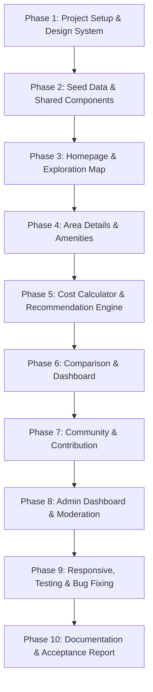

# KẾ HOẠCH TRIỂN KHAI DỰ ÁN STAYWISE (IMPLEMENTATION_PLAN.md)

> **Dự án**: StayWise — Nền tảng phân tích chi phí sinh hoạt đô thị & hỗ trợ quyết định nơi ở (Urban Living Cost Analysis & Housing Decision Platform)  
> **Vai trò**: Staff Software Engineer & Solution Architect  
> **Phiên bản tài liệu**: 1.0.0  
> **Ngày lập**: 22/11/2026  
> **Trạng thái**: KẾ HOẠCH CHI TIẾT — CHỜ PHÊ DUYỆT (CHƯA VIẾT CODE SẢN PHẨM)  
> **Ngôn ngữ triển khai**: Tiếng Việt (UI 100% Tiếng Việt)

---

## MỤC LỤC TÀI LIỆU

1. [Phân tích Yêu cầu & Phạm vi Sản phẩm (Product Scope)](#1-phân-tích-yêu-cầu--phạm-vi-sản-phẩm-product-scope)
2. [Kiến trúc Tổng thể Hệ thống (Architecture Overview)](#2-kiến-trúc-tổng-thể-hệ-thống-architecture-overview)
3. [Cấu trúc Thư mục Chi tiết (Folder Structure)](#3-cấu-trúc-thư-mục-chi-tiết-folder-structure)
4. [Mô hình Dữ liệu & Thiết kế Bộ Dữ liệu Mẫu (Data Model)](#4-mô-hình-dữ-liệu--thiết-kế-bộ-dữ-liệu-mẫu-data-model)
5. [Thiết kế Thuật toán & Nghiệp vụ Cốt lõi (Business Logic)](#5-thiết-kế-thuật-toán--nghiệp-vụ-cốt-lõi-business-logic)
6. [Thiết kế Giao diện & Design System (UI/UX Structure)](#6-thiết-kế-giao-diện--design-system-uiux-structure)
7. [Danh mục Thư viện & Phân tích Độc lập Local (Dependency List)](#7-danh-mục-thư-viện--phân-tích-độc-lập-local-dependency-list)
8. [Bảng Kiểm kê File Cần Tạo (File Creation Checklist)](#8-bảng-kiểm-kê-file-cần-tạo-file-creation-checklist)
9. [Kế hoạch Triển khai theo 10 Giai đoạn (Implementation Phases)](#9-kế-hoạch-triển-khai-theo-10-giai-đoạn-implementation-phases)
10. [Chiến lược & Kịch bản Kiểm thử Toàn diện (Testing Strategy)](#10-chiến-lược--kịch-bản-kiểm-thử-toàn-diện-testing-strategy)
11. [Quản trị Rủi ro & Giải pháp Giảm thiểu (Risks & Mitigations)](#11-quản-trị-rủi-ro--giải-pháp-giảm-thiểu-risks--mitigations)
12. [Tiêu chuẩn Hoàn thành & Kế hoạch Bàn giao (Definition of Done)](#12-tiêu-chuẩn-hoàn-thành--kế-hoạch-bàn-giao-definition-of-done)
13. [Báo cáo Tự Rà soát & Đối chiếu với SPEC.md](#13-báo-cáo-tự-rà-soát--đối-chiếu-với-specmd)

---

## 1. PHÂN TÍCH YÊU CẦU & PHẠM VI SẢN PHẨM (PRODUCT SCOPE)

### 1.1. Mục tiêu và Định vị Sản phẩm
StayWise là nền tảng SaaS hỗ trợ người dùng đô thị (sinh viên, người đi làm) giải quyết bài toán: **"Với ngân sách X triệu và nơi học tập/làm việc tại Y, tôi nên sống ở khu vực nào để vừa tiết kiệm chi phí, vừa đảm bảo chất lượng môi trường sống (an ninh, ngập lụt, giao thông, tiện ích)?"**.

Sản phẩm **không phải** là website rao vặt đăng tin bất động sản, mà là **công cụ phân tích dữ liệu chi phí và hỗ trợ ra quyết định thông minh**, vận hành theo chu trình:
$$\text{EXPLORE} \longrightarrow \text{ANALYZE} \longrightarrow \text{COMPARE} \longrightarrow \text{RECOMMEND} \longrightarrow \text{DECIDE}$$

### 1.2. Danh sách 10 Trang Bắt buộc & Chức năng Cốt lõi

| STT | Tuyến đường (Route) | Tên trang | Mục tiêu & Chức năng chính |
|---|---|---|---|
| 1 | `/` | Trang chủ (Homepage) | Hero section, Search Bar có autocomplete, thống kê động (Quick Stats), xem trước bản đồ nhiệt (Map Preview), danh sách Featured Areas, xem trước bộ tính chi phí, quy trình 3 bước, Community Insights, Footer chuẩn mực. |
| 2 | `/explore` | Khám phá khu vực | Không gian bản đồ lớn (Leaflet) + Bộ lọc đa tiêu chí (Drawer/Sidebar trên mobile), Heatmap đa chế độ, danh sách Card khu vực, đồng bộ tương tác 2 chiều giữa Map Marker và List Card. |
| 3 | `/areas/[slug]` | Chi tiết khu vực | Thông tin tổng quan, biểu đồ cơ cấu chi phí (Recharts Donut/Bar), bản đồ vị trí & khoảng cách tới điểm đến, thanh điểm chất lượng sống (Radar/Bar), danh sách tiện ích phân nhóm, đánh giá đã kiểm duyệt từ cộng đồng, gợi ý khu vực lân cận. |
| 4 | `/calculator` | Tính chi phí sinh hoạt | Form nhập liệu chi tiết theo từng hạng mục sinh hoạt, thanh trượt tùy biến, nạp dữ liệu từ khu vực mẫu, tính toán ngân sách thặng dư/thâm hụt, biểu đồ cơ cấu chi tiêu Pie/Bar, lưu kế hoạch vào LocalStorage. |
| 5 | `/recommendations` | Gợi ý khu vực tối ưu | Biểu mẫu khảo sát nhu cầu (Ngân sách, Tiền thuê tối đa, Điểm đến, Khoảng cách chấp nhận được, Trọng số ưu tiên chuẩn hóa 100%), thuật toán chấm điểm đa mục tiêu minh bạch, danh sách xếp hạng có giải thích chi tiết, biểu đồ phân tích tương quan. |
| 6 | `/compare` | So sánh đối đầu | Chọn tối đa 4 khu vực, bảng so sánh đối sánh đa chiều (Chi phí, Môi trường, Tiện ích), biểu đồ Bar so sánh chi phí, biểu đồ Radar so sánh môi trường sống, hệ thống nhận xét tự động khu vực tốt nhất theo tiêu chí. |
| 7 | `/community` | Cộng đồng & Đánh giá | Bảng tin đánh giá sinh sống đã được kiểm duyệt (Approved), lọc theo thành phố/khu vực/chủ đề, điểm đánh giá trung bình, cam kết tin cậy dữ liệu (Data Trust), CTA dẫn tới đóng góp. |
| 8 | `/contribute` | Đóng góp dữ liệu | Biểu mẫu đóng góp trải nghiệm & chi phí thực tế (React Hook Form + Zod), kiểm tra dữ liệu nghiêm ngặt, lưu vào LocalStorage với trạng thái `pending`, bảng theo dõi trạng thái đóng góp của chính người dùng. |
| 9 | `/dashboard` | Trung tâm phân tích đô thị | Dashboard phân tích dữ liệu tổng thể: KPI cards, chi phí trung bình 2 thành phố, xếp hạng chi phí rẻ nhất/đắt nhất, biểu đồ phân tích 5 chỉ số môi trường sống, bản đồ bao quát thu nhỏ. |
| 10 | `/admin` | Quản trị hệ thống (Demo) | Bảng điều khiển quản trị: KPI tổng quan dữ liệu; `/admin/areas` (CRUD khu vực); `/admin/contributions` (Kiểm duyệt Phê duyệt/Từ chối đóng góp); `/admin/reports` (Thống kê và Xuất báo cáo CSV). |
| * | `/login` | Đăng nhập mô phỏng | Form đăng nhập trải nghiệm quyền Admin (giải thích rõ ràng là mock auth phía client). |
| * | `/not-found` | Trang 404 tùy biến | Thông báo thân thiện, điều hướng quay lại trang chủ và khám phá. |

### 1.3. Phân biệt Server Component và Client Component

Để tối ưu hiệu năng Next.js App Router và tuân thủ các quy tắc SSR:
- **Server Components (RSC)**: Layouts khung sườn (`RootLayout`, `AdminLayout`), các container dữ liệu ban đầu, trang thông tin tĩnh, phần đọc dữ liệu tĩnh trước khi hydrate.
- **Client Components (`'use client'`)**:
  - Tất cả các component tương tác với bản đồ (`LeafletMap`, `HeatmapLayer`, `AreaMarkerLayer`, `AmenityMarkerLayer`).
  - Toàn bộ các component biểu đồ (`Recharts` đòi hỏi đo đạc kích thước viewport của browser).
  - Các form nhập liệu tương tác: Bộ tính toán chi phí, bộ lọc Explore, form gợi ý khu vực, form đóng góp, modal Admin.
  - Các component đọc/ghi LocalStorage (`useStore`, `StoreProvider`).

### 1.4. Nhận diện Rủi ro Kỹ thuật: SSR, Hydration Mismatch & Leaflet
1. **Lỗi `window is not defined` từ Leaflet**: Thư viện Leaflet truy cập trực tiếp `window` và `document` ngay khi import module.
   - *Giải pháp*: Cô lập toàn bộ mã nguồn Leaflet vào thư mục `@/components/map/`, luôn sử dụng `dynamic(() => import(...), { ssr: false })` khi nhúng vào trang, kèm loading placeholder skeleton.
2. **Lỗi `Map container is already initialized`**: Xảy ra khi React render lại component bản đồ mà phiên bản Leaflet map instance cũ chưa được giải phóng (`destroy`/`remove`).
   - *Giải pháp*: Lưu trữ instance bản đồ trong `useRef<L.Map | null>` hoặc dùng hook `useMap` của React-Leaflet, gọi `map.remove()` trong cleanup function của `useEffect`.
3. **Lỗi Hydration Mismatch từ `localStorage`**: Khi HTML sinh ra từ server (SSR) khác với HTML client render sau khi đọc LocalStorage.
   - *Giải pháp*: Áp dụng pattern `useHydratedStore` với cờ `isMounted: boolean`. Trong lần render đầu tiên trên client, luôn hiển thị dữ liệu mặc định (seed data) giống hệt server, sau khi mount thành công mới sync dữ liệu từ LocalStorage vào React state.
4. **Lỗi hiển thị tile OpenStreetMap khi mất kết nối Internet**:
   - *Giải pháp*: Thiết lập fallback tile error listener. Khi tải tile thất bại, bản đồ sẽ tự động kích hoạt chế độ "Bản đồ minh họa ngoại tuyến" (Offline Local Grid/SVG Overlay) vẽ dựa trên tọa độ toán học nội bộ, các Marker và Heatmap layer vẫn hoạt động 100% không làm ứng dụng crash.

---

## 2. KIẾN TRÚC TỔNG THỂ HỆ THỐNG (ARCHITECTURE OVERVIEW)

### 2.1. Sơ đồ Kiến trúc Đa tầng (Layered Architecture)

```
┌─────────────────────────────────────────────────────────────────────────┐
│                      PRESENTATION LAYER (Next.js App Router)            │
│  - App Routes: /, /explore, /areas/[slug], /calculator, /recommendations│
│                /compare, /community, /contribute, /dashboard, /admin    │
│  - Shared UI Components: Button, Input, Modal, Drawer, Card, Badge, etc.│
│  - Layouts: RootLayout (Header/Footer), AdminLayout (Sidebar/TopNav)    │
└────────────────────────────────────┬────────────────────────────────────┘
                                     │ (Props, Events, UI State)
┌────────────────────────────────────▼────────────────────────────────────┐
│                    VISUALIZATION & INTERACTIVE LAYER                    │
│  - Leaflet Map (SSR Disabled Dynamic Import, CircleMarker, DivIcon)     │
│  - Leaflet.heat Layer (Dynamic canvas intensity renderer)               │
│  - Recharts Visualizations (Pie, Bar, Radar, Area with Tooltip/Legend)  │
└────────────────────────────────────┬────────────────────────────────────┘
                                     │ (Chart Data, Coordinates, Bounds)
┌────────────────────────────────────▼────────────────────────────────────┐
│                        APPLICATION & DOMAIN LAYER                       │
│  - Area Services (Querying, Sorting, Filtering, Aggregation)            │
│  - Cost Calculator Service (Budget utilization, Surplus/Deficit)        │
│  - Multi-Criteria Recommendation Engine (Normalized weights scoring)   │
│  - Comparison Engine (Side-by-side matrix, Best-in-class highlighter)   │
│  - Community & Contribution Moderation Service (Pending/Approve/Reject) │
│  - Geo Math Engine (Haversine straight-line distance, bounding boxes)   │
└────────────────────────────────────┬────────────────────────────────────┘
                                     │ (Typed Calls, Pure Functions)
┌────────────────────────────────────▼────────────────────────────────────┐
│               DATA PERSISTENCE & LOCAL STATE LAYER                      │
│  - AppStore Context / Custom Hooks (Reactive State Management)          │
│  - LocalStorage Engine (staywise_storage with Safe Parsing & Fallbacks) │
│  - Static Seed Data (10 Areas, Amenities, Destinations, Reviews)        │
│  - Seed Reset & CSV Exporter Engine                                     │
└─────────────────────────────────────────────────────────────────────────┘
```

### 2.2. Cơ chế Giao tiếp giữa các Thành phần

1. **Từ UI tới Logic nghiệp vụ**: Các UI components không chứa công thức tính toán. Mọi logic tính toán (ví dụ: tính điểm gợi ý, tính tổng tiền, tính khoảng cách) đều được tách thành các pure functions trong `@/lib/calculations/` và `@/lib/recommendations/`. Các hàm này nhận vào dữ liệu thô và trả về kết quả đã format chuẩn xác.
2. **Quản lý State tập trung với React Context (`StoreContext`)**:
   - Quản lý danh sách `areas` (kết hợp seed data + custom areas từ Admin).
   - Quản lý danh sách `contributions` (dữ liệu đóng góp người dùng + seed reviews).
   - Quản lý danh sách so sánh `comparisonAreaIds` (tối đa 4 khu vực).
   - Quản lý thông tin kế hoạch tài chính đã lưu `savedBudgetPlan`.
   - Quản lý tùy chọn ưu tiên gợi ý `userPreferences`.
3. **Đồng bộ xuống `localStorage`**:
   - Khi có thay đổi state (thêm đóng góp, duyệt bài, thêm/sửa/xóa khu vực, lưu kế hoạch), hàm helper `storageService` sẽ serialize và lưu vào LocalStorage dưới các namespace riêng biệt (`staywise_*`).
   - Cung cấp hàm `resetToDefaultData()` để đưa toàn bộ dữ liệu trở về trạng thái seed data ban đầu bất cứ lúc nào.

---

## 3. CẤU TRÚC THƯ MỤC CHI TIẾT (FOLDER STRUCTURE)

```text
d:\MyProject\StayWise/
├── public/
│   ├── favicon.ico
│   └── assets/
│       └── images/             # Placeholder SVGs cho các tiện ích và logo
├── src/
│   ├── app/                    # Next.js 14+ App Router
│   │   ├── layout.tsx          # Root Layout chung cho website công khai
│   │   ├── page.tsx            # / - Trang chủ
│   │   ├── globals.css         # Tailwind & Leaflet global styles
│   │   ├── not-found.tsx       # Custom 404 Page
│   │   ├── error.tsx           # Global Error Boundary
│   │   ├── loading.tsx         # Global Loading Spinner
│   │   │
│   │   ├── explore/
│   │   │   └── page.tsx        # /explore - Khám phá khu vực & Bản đồ
│   │   │
│   │   ├── areas/
│   │   │   └── [slug]/
│   │   │       └── page.tsx    # /areas/[slug] - Chi tiết khu vực
│   │   │
│   │   ├── calculator/
│   │   │   └── page.tsx        # /calculator - Tính toán chi phí sinh hoạt
│   │   │
│   │   ├── recommendations/
│   │   │   └── page.tsx        # /recommendations - Gợi ý khu vực tối ưu
│   │   │
│   │   ├── compare/
│   │   │   └── page.tsx        # /compare - So sánh khu vực
│   │   │
│   │   ├── community/
│   │   │   └── page.tsx        # /community - Bảng tin cộng đồng
│   │   │
│   │   ├── contribute/
│   │   │   └── page.tsx        # /contribute - Gửi đóng góp dữ liệu
│   │   │
│   │   ├── dashboard/
│   │   │   └── page.tsx        # /dashboard - Thống kê & Phân tích đô thị
│   │   │
│   │   ├── login/
│   │   │   └── page.tsx        # /login - Đăng nhập quản trị mô phỏng
│   │   │
│   │   └── admin/
│   │       ├── layout.tsx      # Admin Layout (Sidebar & Topbar)
│   │       ├── page.tsx        # /admin - Tổng quan Admin
│   │       ├── areas/
│   │       │   └── page.tsx    # /admin/areas - Quản lý khu vực (CRUD)
│   │       ├── contributions/
│   │       │   └── page.tsx    # /admin/contributions - Duyệt đóng góp
│   │       └── reports/
│   │           └── page.tsx    # /admin/reports - Báo cáo & Xuất CSV
│   │
│   ├── components/
│   │   ├── layout/             # Header, Footer, AdminSidebar, AdminHeader, MobileNav
│   │   │   ├── Header.tsx
│   │   │   ├── Footer.tsx
│   │   │   ├── AdminSidebar.tsx
│   │   │   ├── AdminHeader.tsx
│   │   │   └── MobileNav.tsx
│   │   │
│   │   ├── common/             # Atomic UI Components
│   │   │   ├── Button.tsx
│   │   │   ├── Input.tsx
│   │   │   ├── Select.tsx
│   │   │   ├── Slider.tsx
│   │   │   ├── Modal.tsx
│   │   │   ├── Badge.tsx
│   │   │   ├── Tabs.tsx
│   │   │   ├── Toast.tsx
│   │   │   ├── EmptyState.tsx
│   │   │   ├── LoadingSkeleton.tsx
│   │   │   └── ConfirmationDialog.tsx
│   │   │
│   │   ├── cards/              # Thẻ hiển thị nghiệp vụ
│   │   │   ├── AreaCard.tsx
│   │   │   ├── StatCard.tsx
│   │   │   ├── ReviewCard.tsx
│   │   │   ├── RecommendationCard.tsx
│   │   │   └── AmenityCard.tsx
│   │   │
│   │   ├── map/                # Cô lập bản đồ Leaflet (Dynamic Only)
│   │   │   ├── MapContainerWrapper.tsx   # Wrapper client kiểm tra SSR
│   │   │   ├── LeafletMap.tsx            # Bản đồ tương tác chính
│   │   │   ├── HeatmapLayer.tsx          # Lớp Heatmap Leaflet.heat
│   │   │   ├── AreaMarkerLayer.tsx       # Lớp Marker khu vực (DivIcon/CircleMarker)
│   │   │   ├── AmenityMarkerLayer.tsx    # Lớp Marker tiện ích
│   │   │   ├── MapLegend.tsx             # Chú thích thang màu & ký hiệu
│   │   │   ├── MapControls.tsx           # Bộ điều khiển Zoom / Bounds / Layers
│   │   │   └── OfflineMapFallback.tsx    # Giao diện fallback khi mất mạng
│   │   │
│   │   ├── charts/             # Biểu đồ Recharts
│   │   │   ├── ExpensePieChart.tsx       # Cơ cấu chi phí Donut/Pie
│   │   │   ├── BudgetBarChart.tsx        # Chi phí so với ngân sách
│   │   │   ├── ComparisonBarChart.tsx    # So sánh chi phí nhiều khu vực
│   │   │   ├── LivingScoreRadarChart.tsx # Radar so sánh 5 tiêu chí sống
│   │   │   └── AdminTrendLineChart.tsx   # Xu hướng đóng góp thời gian
│   │   │
│   │   └── forms/              # Biểu mẫu tái sử dụng
│   │       ├── SearchBar.tsx
│   │       ├── AreaFilterForm.tsx
│   │       ├── CostInputForm.tsx
│   │       ├── PreferenceForm.tsx
│   │       ├── ContributionForm.tsx
│   │       └── AreaEditModal.tsx
│   │
│   ├── features/               # Các trang lớn / module tính năng độc lập
│   │   ├── explore/
│   │   │   ├── ExploreView.tsx
│   │   │   └── FilterDrawer.tsx
│   │   ├── calculator/
│   │   │   └── CalculatorView.tsx
│   │   ├── recommendations/
│   │   │   └── RecommendationView.tsx
│   │   ├── comparison/
│   │   │   ├── ComparisonTable.tsx
│   │   │   └── ComparisonView.tsx
│   │   ├── community/
│   │   │   └── CommunityFeed.tsx
│   │   └── admin/
│   │       ├── AreaTable.tsx
│   │       └── ModerationList.tsx
│   │
│   ├── data/                   # Dữ liệu tĩnh minh họa (Seed Data)
│   │   ├── areas.ts            # 10 khu vực Hà Nội & TP.HCM
│   │   ├── amenities.ts        # Tiện ích mẫu liên kết areaId
│   │   ├── reviews.ts          # Đánh giá mẫu ban đầu
│   │   ├── contributions.ts    # Đóng góp mẫu ban đầu
│   │   ├── destinations.ts     # Các trường ĐH, tòa nhà văn phòng tham chiếu
│   │   └── index.ts            # Re-export dữ liệu
│   │
│   ├── types/                  # Định nghĩa kiểu dữ liệu TypeScript
│   │   ├── area.ts
│   │   ├── amenity.ts
│   │   ├── review.ts
│   │   ├── contribution.ts
│   │   ├── recommendation.ts
│   │   ├── calculator.ts
│   │   └── admin.ts
│   │
│   ├── lib/                    # Logic tính toán & tiện ích dùng chung
│   │   ├── calculations/
│   │   │   ├── cost.ts         # Tính toán chi phí & thặng dư
│   │   │   ├── distance.ts     # Công thức Haversine tính khoảng cách
│   │   │   └── scores.ts       # Tính điểm tổng hợp môi trường sống
│   │   ├── recommendations/
│   │   │   └── engine.ts       # Thuật toán gợi ý đa tiêu chí
│   │   ├── storage/
│   │   │   ├── local-storage.ts# Trình bọc an toàn cho LocalStorage
│   │   │   └── keys.ts         # Hằng số định danh key
│   │   ├── map/
│   │   │   ├── colors.ts       # Thang màu Heatmap & Marker
│   │   │   └── helpers.ts      # Bounding box & geometry helpers
│   │   ├── formatting/
│   │   │   ├── currency.ts     # Định dạng tiền tệ VND / triệu đồng
│   │   │   └── date.ts         # Định dạng ngày tháng tiếng Việt
│   │   ├── validation/
│   │   │   ├── contribution.ts # Zod schema cho contribution
│   │   │   └── area.ts         # Zod schema cho area
│   │   ├── export/
│   │   │   └── csv.ts          # Xuất dữ liệu sang file CSV
│   │   └── utils.ts            # clsx & twMerge helper
│   │
│   ├── context/                # Trạng thái toàn cục (State Management)
│   │   ├── StoreContext.tsx    # Quản lý Areas, Contributions, Compare list
│   │   └── ToastContext.tsx    # Hệ thống thông báo Toast
│   │
│   └── hooks/                  # Custom Hooks
│       ├── useStore.ts
│       ├── useToast.ts
│       ├── useDebounce.ts
│       ├── useWindowSize.ts
│       └── useMapInstance.ts
│
├── tests/                      # Kiểm thử tự động
│   ├── unit/
│   │   ├── cost-calculation.test.ts
│   │   ├── distance-calculation.test.ts
│   │   ├── recommendation-engine.test.ts
│   │   └── storage.test.ts
│   └── functional/
│       └── filter-and-compare.test.ts
│
├── artifacts/                  # Thư mục lưu trữ báo cáo & hình ảnh nghiệm thu
│   ├── screenshots/            # Ảnh chụp desktop & mobile các màn hình
│   └── ACCEPTANCE_REPORT.md    # Báo cáo nghiệm thu chính thức
│
├── SPEC.md                     # Tài liệu đặc tả sản phẩm
├── IMPLEMENTATION_PLAN.md      # Tài liệu kế hoạch này
├── package.json
├── tsconfig.json
├── tailwind.config.ts
└── README.md
```

---

## 4. MÔ HÌNH DỮ LIỆU & THIẾT KẾ BỘ DỮ LIỆU MẪU (DATA MODEL)

### 4.1. TypeScript Interfaces Chuẩn Xác

```typescript
// types/area.ts
export type CityCode = "hanoi" | "hcm";

export interface MonthlyExpenses {
  food: number;           // Chi phí ăn uống (triệu VNĐ/tháng)
  transportation: number; // Chi phí đi lại (triệu VNĐ/tháng)
  utilities: number;      // Điện, nước, Internet (triệu VNĐ/tháng)
  other: number;          // Chi tiêu cá nhân & phát sinh (triệu VNĐ/tháng)
}

export interface RentRange {
  min: number;            // Giá thuê tối thiểu
  max: number;            // Giá thuê tối đa
  average: number;        // Giá thuê trung bình tham chiếu
}

export interface LivingScores {
  safety: number;             // An ninh (1-5, càng cao càng tốt)
  quietness: number;          // Yên tĩnh (1-5, càng cao càng tốt)
  trafficConvenience: number; // Giao thông thuận tiện (1-5, càng cao càng tốt)
  environment: number;        // Chất lượng môi trường (1-5, càng cao càng tốt)
  floodRisk: number;          // Nguy cơ ngập (1-5, điểm cao = nguy cơ ngập cao)
}

export interface AmenityCounts {
  restaurants: number;
  affordableFood: number;
  supermarkets: number;
  markets: number;
  schools: number;
  hospitals: number;
  busStops: number;
  pharmacies: number;
  convenienceStores: number;
}

export interface Area {
  id: string;                 // VD: "cau-giay"
  slug: string;               // VD: "cau-giay"
  name: string;               // VD: "Cầu Giấy"
  city: CityCode;             // "hanoi" | "hcm"
  displayCity: string;        // "Hà Nội" | "TP. Hồ Chí Minh"
  latitude: number;
  longitude: number;
  rent: RentRange;
  monthlyExpenses: MonthlyExpenses;
  livingScores: LivingScores;
  amenities: AmenityCounts;
  description: string;
  highlights: string[];
  updatedAt: string;
}

// types/amenity.ts
export type AmenityCategory = 
  | "restaurant" 
  | "affordableFood" 
  | "supermarket" 
  | "market" 
  | "school" 
  | "hospital" 
  | "busStop" 
  | "pharmacy" 
  | "convenienceStore";

export interface AmenityItem {
  id: string;
  name: string;
  category: AmenityCategory;
  areaId: string;
  latitude: number;
  longitude: number;
  description: string;
  distanceKm?: number;
}

// types/contribution.ts
export type ContributionCategory = 
  | "security" 
  | "quietness" 
  | "flooding" 
  | "traffic" 
  | "utilities" 
  | "rental" 
  | "general";

export type ContributionStatus = "pending" | "approved" | "rejected";

export interface Contribution {
  id: string;
  areaId: string;
  authorName: string;
  category: ContributionCategory;
  rating: number; // 1 - 5
  content: string;
  status: ContributionStatus;
  createdAt: string;
  updatedAt?: string;
}

// types/destination.ts
export interface Destination {
  id: string;
  name: string;
  city: CityCode;
  category: "university" | "workplace" | "landmark";
  latitude: number;
  longitude: number;
}
```

### 4.2. Bảng 10 Khu vực Tham chiếu Chuẩn Hóa Theo SPEC.md

Toàn bộ dữ liệu được lưu trong `@/data/areas.ts` với nhãn minh họa bắt buộc:
> *"Dữ liệu minh họa — Không thay thế số liệu khảo sát thực tế."*

| Khu vực (ID/Slug) | Thành phố | Tọa độ (Lat, Lng) | Thuê TB | Ăn uống | Đi lại | Điện/Nước/Net | Khác | **Tổng CP Tính Toán** |
|---|---|---|---|---|---|---|---|---|
| **Cầu Giấy** (`cau-giay`) | Hà Nội | `21.030, 105.790` | 4.2 | 2.6 | 0.8 | 0.65 | 1.1 | **9.35 triệu** |
| **Mỹ Đình** (`my-dinh`) | Hà Nội | `21.028, 105.770` | 3.8 | 2.5 | 0.85 | 0.65 | 1.0 | **8.80 triệu** |
| **Hà Đông** (`ha-dong`) | Hà Nội | `20.971, 105.779` | 3.2 | 2.4 | 0.9 | 0.62 | 0.95 | **8.07 triệu** |
| **Đống Đa** (`dong-da`) | Hà Nội | `21.018, 105.826` | 4.5 | 2.8 | 0.75 | 0.7 | 1.2 | **9.95 triệu** |
| **Long Biên** (`long-bien`) | Hà Nội | `21.046, 105.895` | 3.3 | 2.5 | 0.9 | 0.65 | 1.0 | **8.35 triệu** |
| **Thủ Đức** (`thu-duc`) | TP.HCM | `10.850, 106.770` | 3.8 | 2.8 | 1.0 | 0.7 | 1.2 | **9.50 triệu** |
| **Bình Thạnh** (`binh-thanh`)| TP.HCM | `10.810, 106.710` | 4.6 | 2.9 | 0.85 | 0.72 | 1.2 | **10.27 triệu** |
| **Gò Vấp** (`go-vap`) | TP.HCM | `10.840, 106.670` | 3.3 | 2.6 | 1.0 | 0.65 | 1.0 | **8.55 triệu** |
| **Tân Bình** (`tan-binh`) | TP.HCM | `10.800, 106.650` | 4.2 | 2.8 | 0.85 | 0.7 | 1.15 | **9.70 triệu** |
| **Quận 7** (`quan-7`) | TP.HCM | `10.730, 106.720` | 4.8 | 3.0 | 0.9 | 0.75 | 1.3 | **10.75 triệu** |

*Nguyên tắc kiến trúc*: **Tổng chi phí tham chiếu** luôn được tính động thông qua hàm `calculateMonthlyCost()`:
$$\text{Total Cost} = \text{Rent} + \text{Food} + \text{Transport} + \text{Utilities} + \text{Other}$$
Tuyệt đối không lưu giá trị cứng (hardcode) vào đối tượng Area để bảo toàn tính toàn vẹn dữ liệu.

### 4.3. Liên kết Dữ liệu (Relational Mapping bằng ID)
- `Area.id` là khóa chính (Primary Key).
- `AmenityItem.areaId` tham chiếu tới `Area.id`. Mỗi khu vực có từ 8 - 15 tiện ích mẫu tại `@/data/amenities.ts`.
- `Contribution.areaId` tham chiếu tới `Area.id`.
- `Destination.city` phân chia theo thành phố để người dùng dễ dàng chọn trường học/nơi làm việc mục tiêu tại `@/data/destinations.ts` (ví dụ: ĐH Quốc gia Hà Nội, ĐH Bách Khoa, Keangnam Landmark 72, ĐH Bách Khoa TP.HCM, Landmark 81, Bitexco...).

### 4.4. Cơ chế Sinh Heatmap từ Tọa độ và Chỉ số
Dữ liệu cho `Leaflet.heat` được chuyển đổi động dựa trên loại dữ liệu người dùng lựa chọn:
$$\text{Point} = [\text{latitude}, \text{longitude}, \text{intensity}]$$
Trong đó `intensity` được chuẩn hóa về thang $[0.2, 1.0]$:
- Khi xem **Tổng chi phí**: Chuẩn hóa dựa trên $\frac{\text{Chi phí khu vực} - \text{Min}}{\text{Max} - \text{Min}}$.
- Khi xem **Nguy cơ ngập**: Dựa trên `livingScores.floodRisk / 5.0`.
- Khi xem **Chất lượng sống**: Dựa trên điểm môi trường sống trung bình.

---

## 5. THIẾT KẾ THUẬT TOÁN & NGHIỆP VỤ CỐT LÕI (BUSINESS LOGIC)

Toàn bộ các hàm nghiệp vụ được thiết kế độc lập, không phụ thuộc UI, không cần API bên ngoài và 100% kiểm thử được bằng Unit Test.

### 5.1. Bảng Đặc tả Hàm Nghiệp vụ

| Tên Hàm | Input | Output | Trách nhiệm Nghiệp vụ | File Implementation |
|---|---|---|---|---|
| `calculateMonthlyCost` | `(rent, food, transport, utilities, other)` | `number` | Tính tổng chi phí sinh hoạt hàng tháng. Đảm bảo làm tròn 2 chữ số thập phân. | `@/lib/calculations/cost.ts` |
| `calculateBudgetBreakdown` | `(budget, expenses)` | `BudgetResult` | Tính số tiền dư/thâm hụt, tỷ lệ phần trăm tiền thuê, tỷ lệ sinh hoạt, trạng thái tài chính (an toàn / cảnh báo / vượt chi). | `@/lib/calculations/cost.ts` |
| `calculateDistance` | `(lat1, lon1, lat2, lon2)` | `number` | Tính khoảng cách đường chim bay giữa 2 điểm tọa độ theo công thức Haversine (đơn vị: km). | `@/lib/calculations/distance.ts` |
| `calculateAreaScore` | `(area, preferences)` | `AreaScoreResult` | Tính điểm phù hợp (0-100) cho từng khu vực dựa trên 4 thành phần (Ngân sách, Khoảng cách, Tiện ích, Môi trường) và chuẩn hóa trọng số. | `@/lib/recommendations/engine.ts` |
| `recommendAreas` | `(areas, preferences)` | `RecommendedArea[]` | Chấm điểm, lọc các khu vực vượt ngân sách hoặc quá xa, sắp xếp giảm dần theo điểm và sinh danh sách lý do gợi ý minh bạch. | `@/lib/recommendations/engine.ts` |
| `compareAreas` | `(areas, destination?)` | `ComparisonReport` | Phân tích ma trận đối đầu tối đa 4 khu vực; xác định khu vực rẻ nhất, gần nhất, môi trường tốt nhất, tiện ích đa dạng nhất. | `@/lib/calculations/scores.ts` |
| `filterAreas` | `(areas, filters)` | `Area[]` | Lọc khu vực theo thành phố, khoảng giá thuê, tổng chi phí, điểm tối thiểu các chỉ số sống (an ninh, yên tĩnh, ngập lụt) và số lượng tiện ích. | `@/lib/calculations/scores.ts` |
| `submitContribution` | `(data: CreateContributionInput)` | `Contribution` | Validate dữ liệu bằng Zod, sinh UUID ngẫu nhiên, gán status `pending`, lưu vào LocalStorage và dispatch event cập nhật state. | `@/lib/storage/local-storage.ts` |
| `approveContribution` | `(id: string)` | `boolean` | Chuyển trạng thái đóng góp sang `approved`, cập nhật LocalStorage; nội dung ngay lập tức xuất hiện trên trang `/community` và `/areas/[slug]`. | `@/lib/storage/local-storage.ts` |
| `rejectContribution` | `(id: string)` | `boolean` | Chuyển trạng thái đóng góp sang `rejected`, cập nhật LocalStorage; không hiển thị trên giao diện người dùng công khai. | `@/lib/storage/local-storage.ts` |
| `exportAreasToCSV` | `(areas: Area[])` | `string (blob)` | Tạo định dạng CSV chuẩn UTF-8 (có BOM hỗ trợ tiếng Việt trong Excel) để tải về máy. | `@/lib/export/csv.ts` |

### 5.2. Công thức Thuật toán Gợi ý Minh bạch (Recommendation Algorithm)

Không sử dụng "AI ảo" hay black-box API. Thuật toán phân tích định lượng đa tiêu chí (Multi-Criteria Decision Making):
$$\text{Total Score} = (S_{\text{budget}} \times W_1) + (S_{\text{commute}} \times W_2) + (S_{\text{amenities}} \times W_3) + (S_{\text{environment}} \times W_4)$$
*Trong đó*:
1. **Chuẩn hóa Trọng số**:
   $$W_i = \frac{w_i}{\sum_{j=1}^{4} w_j}$$
   Trọng số mặc định: Ngân sách $40\%$, Đi lại $25\%$, Tiện ích $15\%$, Môi trường $20\%$.
2. **Điểm Ngân sách ($S_{\text{budget}}$)**:
   - Nếu $\text{Tổng chi phí} \le \text{Ngân sách}$: Điểm từ $80 - 100$ điểm (thặng dư càng nhiều điểm càng cao).
   - Nếu $\text{Tổng chi phí} > \text{Ngân sách}$: Bị phạt điểm theo tỷ lệ vượt: $\max\left(0, 70 - \frac{\text{Vượt}}{\text{Ngân sách}} \times 200\right)$.
3. **Điểm Đi lại ($S_{\text{commute}}$)**:
   - Nếu chưa chọn điểm đến: Gán mặc định 75 điểm.
   - Nếu có điểm đến: Tính theo khoảng cách $d$ (km) và cự ly tối đa $D_{\max}$:
     $$S_{\text{commute}} = \max\left(0, 100 - \left(\frac{d}{D_{\max}}\right) \times 80\right)$$
4. **Điểm Tiện ích ($S_{\text{amenities}}$)**:
   - Tổng hợp số lượng các tiện ích thiết yếu (quán ăn bình dân, siêu thị, chợ, trạm xe buýt) chuẩn hóa về thang $0 - 100$.
5. **Điểm Môi trường ($S_{\text{environment}}$)**:
   $$S_{\text{environment}} = \frac{\text{An ninh} + \text{Yên tĩnh} + \text{Giao thông} + \text{Môi trường} + (6 - \text{Nguy cơ ngập})}{25} \times 100$$
   *(Lưu ý: Nguy cơ ngập được đảo chiều vì điểm ngập càng cao thì rủi ro càng lớn).*

---

## 6. THIẾT KẾ GIAO DIỆN & DESIGN SYSTEM (UI/UX STRUCTURE)

### 6.1. Design Tokens & Bảng màu (Color Palette)

Phong cách thiết kế: **Modern SaaS, Data-driven, Clean & High Trust**.

```css
/* Tailwind theme configuration */
:root {
  /* Primary - Xanh lá sinh thái, phát triển, chi phí thông minh */
  --color-primary: #16A36A;
  --color-primary-hover: #128456;
  --color-primary-light: #E8F7EF;
  --color-primary-dark: #08734A;

  /* Secondary - Navy công nghệ, tin cậy, vững chãi */
  --color-navy: #17324D;
  --color-navy-light: #EAF0F6;
  --color-navy-dark: #102438;

  /* Neutral - Nền sáng hiện đại */
  --color-bg: #F7F9FC;
  --color-surface: #FFFFFF;
  --color-border: #E5EAF0;
  --color-text-primary: #182230;
  --color-text-secondary: #667085;
  --color-text-muted: #98A2B3;

  /* Status & Accent */
  --color-warning: #F5A623;
  --color-warning-light: #FFF4DB;
  --color-danger: #E45A5A;
  --color-danger-light: #FDECEC;
  --color-info: #3B82F6;
  --color-info-light: #EAF3FF;
}
```

### 6.2. Typography & Phông chữ
- Phông chữ chính: **Inter** hoặc **Geist Sans**, hỗ trợ dấu tiếng Việt chuẩn và bảng mã Unicode hoàn chỉnh.
- Cấp bậc kiểu chữ (Typography Hierarchy):
  - Heading 1 (Hero Title): `text-4xl lg:text-5xl font-extrabold tracking-tight text-navy`
  - Heading 2 (Section Title): `text-2xl lg:text-3xl font-bold text-navy`
  - Heading 3 (Card Title): `text-lg lg:text-xl font-semibold text-textPrimary`
  - Body Normal: `text-sm lg:text-base font-normal text-textSecondary leading-relaxed`
  - Small / Caption: `text-xs font-medium text-textMuted`

### 6.3. Bố cục Đa Màn hình (Responsive Breakpoints)

| Kích thước | Phân loại | Quy tắc bố cục giao diện |
|---|---|---|
| **$\ge 1280\text{px}$** | Desktop / Laptop | Thanh điều hướng Top Nav đầy đủ; Trang Explore hiển thị song song 2 cột: Bộ lọc & Danh sách khu vực (40%) và Bản đồ lớn cố định (60%); Admin hiển thị Sidebar cố định bên trái (260px). |
| **$768\text{px} - 1023\text{px}$** | Tablet | Bộ lọc thu gọn vào Drawer hoặc Dropdown phía trên; Bảng so sánh cho phép cuộn ngang có sticky cột đầu tiên; Biểu đồ Recharts tự co dãn độ rộng 100%. |
| **$\le 767\text{px}$** | Mobile | Top Nav chuyển thành Hamburger Menu kèm Bottom Sheet Drawer; Trang Explore có tab chuyển đổi linh hoạt: **[Xem Danh Sách]** $\leftrightarrow$ **[Xem Bản Đồ]** để tránh xung đột cử chỉ chạm (touch gesture); Kích thước touch target tối thiểu 44x44px. |

### 6.4. Thiết kế Thành phần Dùng chung (Shared Components)
- **AreaCard**: Hiển thị tên khu vực, badge thành phố, giá thuê trung bình, tổng chi phí tham chiếu, điểm chất lượng môi trường dạng thanh tiến trình (progress bar), nút "Xem chi tiết" và nút checkbox/toggle "Thêm vào so sánh".
- **StatCard**: Thẻ KPI hiển thị số liệu phân tích lớn, icon Lucide viền màu pastel, tỷ lệ phần trăm thay đổi hoặc nhãn ghi chú minh họa.
- **MapLegend**: Bảng chú giải nổi trên góc bản đồ, giải thích dải màu từ xanh lá (chi phí thấp/môi trường tốt) đến cam/đỏ (chi phí cao/nguy cơ ngập).
- **ConfirmationDialog**: Hộp thoại xác nhận hành động nguy hiểm (Xóa khu vực, Khôi phục seed data) với 2 nút Hủy và Đồng ý rõ ràng.

---

## 7. DANH MỤC THƯ VIỆN & PHÂN TÍCH ĐỘC LẬP LOCAL (DEPENDENCY LIST)

### 7.1. Bảng Dependencies Cần Cài đặt

```json
{
  "dependencies": {
    "next": "^14.2.0",
    "react": "^18.3.0",
    "react-dom": "^18.3.0",
    "typescript": "^5.4.0",
    "tailwindcss": "^3.4.0",
    "lucide-react": "^0.378.0",
    "recharts": "^2.12.0",
    "leaflet": "^1.9.4",
    "react-leaflet": "^4.2.1",
    "leaflet.heat": "^0.2.0",
    "react-hook-form": "^7.51.0",
    "zod": "^3.23.0",
    "@hookform/resolvers": "^3.3.4",
    "date-fns": "^3.6.0",
    "clsx": "^2.1.1",
    "tailwind-merge": "^2.3.0"
  },
  "devDependencies": {
    "@types/node": "^20.12.0",
    "@types/react": "^18.3.0",
    "@types/react-dom": "^18.3.0",
    "@types/leaflet": "^1.9.11",
    "@types/leaflet.heat": "^0.2.4",
    "postcss": "^8.4.38",
    "autoprefixer": "^10.4.19",
    "vitest": "^1.6.0",
    "@testing-library/react": "^15.0.0",
    "@testing-library/jest-dom": "^6.4.0",
    "jsdom": "^24.0.0"
  }
}
```

### 7.2. Cam kết 100% Chạy Local Không Cần API Key Trả Phí
- **Không Google Maps API / Mapbox API**: Sử dụng OpenStreetMap miễn phí kết hợp Leaflet.
- **Không Geocoding API**: Sử dụng bảng tọa độ cục bộ (`@/data/destinations.ts` và `@/data/areas.ts`).
- **Không Third-Party Backend**: Sử dụng LocalStorage với khả năng đồng bộ trạng thái qua custom hooks.
- **Cơ chế Fallback Ngoại tuyến**: Tạo sẵn `OfflineMapFallback.tsx` - một canvas minh họa lưới tọa độ phẳng. Nếu trình duyệt không kết nối mạng và không tải được tile OpenStreetMap, ứng dụng tự động hiển thị lưới minh họa này, vẫn vẽ trọn vẹn các CircleMarker và điểm Heatmap mà không hề báo lỗi đỏ trên console.

---

## 8. BẢNG KIỂM KÊ FILE CẦN TẠO (FILE CREATION CHECKLIST)

Bảng tổng hợp chi tiết tất cả các file trong dự án, đảm bảo không có file thừa và không thiếu bất kỳ tính năng nào của SPEC.md:

| Nhóm | Vị trí File | Trách nhiệm Nghiệp vụ | Dependencies Chính |
|---|---|---|---|
| **Configuration** | `package.json` | Khai báo dependencies, scripts chạy dev, build, lint, test | Next.js, React, Tailwind, Leaflet |
| **Configuration** | `tsconfig.json` | Cấu hình TypeScript strict mode và path alias `@/*` | TypeScript |
| **Configuration** | `tailwind.config.ts` | Khai báo bảng màu StayWise, tokens, font chữ và responsive | Tailwind CSS |
| **Configuration** | `postcss.config.js` | Cấu hình PostCSS cho Tailwind | PostCSS, Autoprefixer |
| **App Routes** | `src/app/layout.tsx` | Root layout cho trang người dùng, nạp StoreProvider và ToastProvider | React, Header, Footer |
| **App Routes** | `src/app/globals.css` | Import Tailwind directives và Leaflet CSS styles | Tailwind CSS, Leaflet CSS |
| **App Routes** | `src/app/page.tsx` | Trang chủ StayWise với 9 sections hoàn chỉnh | Lucide, AreaCard, Recharts, Map |
| **App Routes** | `src/app/explore/page.tsx` | Trang khám phá khu vực, bộ lọc và bản đồ tương tác | ExploreView, LeafletMap, AreaCard |
| **App Routes** | `src/app/areas/[slug]/page.tsx` | Trang chi tiết khu vực theo slug động | Recharts, LeafletMap, ReviewCard |
| **App Routes** | `src/app/calculator/page.tsx` | Trang công cụ tính chi phí sinh hoạt cá nhân hóa | CalculatorView, Recharts |
| **App Routes** | `src/app/recommendations/page.tsx` | Trang khảo sát và gợi ý khu vực tối ưu | RecommendationView, Engine |
| **App Routes** | `src/app/compare/page.tsx` | Trang so sánh đối kháng tối đa 4 khu vực | ComparisonView, RadarChart |
| **App Routes** | `src/app/community/page.tsx` | Bảng tin cộng đồng và danh sách đánh giá đã duyệt | CommunityFeed, ReviewCard |
| **App Routes** | `src/app/contribute/page.tsx` | Biểu mẫu gửi đóng góp chi phí và trải nghiệm | ContributionForm, React Hook Form |
| **App Routes** | `src/app/dashboard/page.tsx` | Trung tâm phân tích dữ liệu tổng thể đô thị | Recharts, StatCard, LeafletMap |
| **App Routes** | `src/app/login/page.tsx` | Giao diện đăng nhập quản trị mô phỏng client-side | React, Form, Button |
| **App Routes** | `src/app/admin/layout.tsx` | Layout quản trị với Sidebar và Header riêng | AdminSidebar, AdminHeader |
| **App Routes** | `src/app/admin/page.tsx` | Dashboard tổng quan quản trị dữ liệu | AdminTrendLineChart, StatCard |
| **App Routes** | `src/app/admin/areas/page.tsx` | Bảng quản lý khu vực (Thêm, Sửa, Xóa, Reset) | AreaTable, AreaEditModal |
| **App Routes** | `src/app/admin/contributions/page.tsx` | Bảng kiểm duyệt đóng góp (Duyệt/Từ chối) | ModerationList, Button, Badge |
| **App Routes** | `src/app/admin/reports/page.tsx` | Thống kê chất lượng dữ liệu và nút xuất CSV | Recharts, CSV Export Engine |
| **App Routes** | `src/app/not-found.tsx` | Trang 404 thân thiện | Lucide, Button |
| **App Routes** | `src/app/error.tsx` | Error boundary hiển thị fallback khi có sự cố | Button, AlertTriangle |
| **Layouts** | `src/components/layout/Header.tsx` | Thanh điều hướng chính, logo, search bar, menu desktop | Lucide, Link, MobileNav |
| **Layouts** | `src/components/layout/Footer.tsx` | Chân trang: giới thiệu, điều khoản, miễn trừ dữ liệu mẫu | Link |
| **Layouts** | `src/components/layout/AdminSidebar.tsx` | Menu điều hướng sidebar cho trang quản trị | Lucide, Link, usePathname |
| **Layouts** | `src/components/layout/AdminHeader.tsx` | Top bar quản trị: thông tin admin demo, nút quay lại web | Lucide, Button |
| **Layouts** | `src/components/layout/MobileNav.tsx` | Menu ngăn kéo (Drawer) dành cho thiết bị di động | Lucide, Link |
| **Shared Components** | `src/components/common/Button.tsx` | Nút bấm tái sử dụng (Primary, Outline, Danger, Ghost) | clsx, tailwind-merge |
| **Shared Components** | `src/components/common/Input.tsx` | Trường nhập văn bản chuẩn hóa giao diện và thông báo lỗi | React |
| **Shared Components** | `src/components/common/Select.tsx` | Dropdown chọn thành phố/danh mục | React |
| **Shared Components** | `src/components/common/Slider.tsx` | Thanh trượt tùy chỉnh ngân sách và trọng số gợi ý | React |
| **Shared Components** | `src/components/common/Modal.tsx` | Hộp thoại nổi (Dialog) kèm backdrop và phím Escape | React, Portal |
| **Shared Components** | `src/components/common/Badge.tsx` | Huy hiệu trạng thái (Pending, Approved, Warning, City) | clsx |
| **Shared Components** | `src/components/common/Tabs.tsx` | Bộ tab chuyển đổi chế độ xem | React |
| **Shared Components** | `src/components/common/Toast.tsx` | Thông báo nổi khi thao tác thành công hoặc gặp lỗi | Lucide |
| **Shared Components** | `src/components/common/EmptyState.tsx` | Trạng thái rỗng khi không có kết quả tìm kiếm/lọc | Lucide, Button |
| **Shared Components** | `src/components/common/LoadingSkeleton.tsx` | Khung xương tải trang chống giật layout | Tailwind |
| **Shared Components** | `src/components/common/ConfirmationDialog.tsx` | Hộp thoại xác nhận các thao tác xóa/reset | Modal, Button |
| **Feature Cards** | `src/components/cards/AreaCard.tsx` | Thẻ khu vực hiển thị giá, điểm sống, nút xem/so sánh | Link, Badge, Button |
| **Feature Cards** | `src/components/cards/StatCard.tsx` | Thẻ thống kê chỉ số KPI với icon và tỷ lệ | Lucide |
| **Feature Cards** | `src/components/cards/ReviewCard.tsx` | Thẻ nhận xét cộng đồng kèm xếp hạng sao và nhãn duyệt | Lucide, Badge |
| **Feature Cards** | `src/components/cards/RecommendationCard.tsx`| Thẻ hiển thị khu vực được gợi ý kèm danh sách lý do | Lucide, Button |
| **Feature Cards** | `src/components/cards/AmenityCard.tsx` | Thẻ thông tin tiện ích xung quanh | Lucide |
| **Map Components** | `src/components/map/MapContainerWrapper.tsx` | Client wrapper import LeafletMap động không SSR | next/dynamic |
| **Map Components** | `src/components/map/LeafletMap.tsx` | Trình hiển thị bản đồ Leaflet, gán tile và điều khiển | Leaflet, React-Leaflet |
| **Map Components** | `src/components/map/HeatmapLayer.tsx` | Lớp vẽ Heatmap canvas bằng Leaflet.heat | Leaflet.heat |
| **Map Components** | `src/components/map/AreaMarkerLayer.tsx` | Lớp hiển thị marker khu vực bằng CircleMarker/DivIcon | Leaflet, Lucide |
| **Map Components** | `src/components/map/AmenityMarkerLayer.tsx` | Lớp hiển thị tiện ích khi được người dùng bật | Leaflet |
| **Map Components** | `src/components/map/MapLegend.tsx` | Chú thích thang màu chi phí và chất lượng sống | React |
| **Map Components** | `src/components/map/MapControls.tsx` | Nút bấm phóng to, thu nhỏ, fit bounds, bật tắt lớp | Lucide, useMap |
| **Map Components** | `src/components/map/OfflineMapFallback.tsx` | Giao diện bản đồ minh họa ngoại tuyến khi mất mạng | SVG, Canvas |
| **Chart Components** | `src/components/charts/ExpensePieChart.tsx` | Biểu đồ tròn/donut cơ cấu chi tiêu | Recharts |
| **Chart Components** | `src/components/charts/BudgetBarChart.tsx` | Biểu đồ cột so sánh chi phí với ngân sách | Recharts |
| **Chart Components** | `src/components/charts/ComparisonBarChart.tsx`| Biểu đồ cột nhóm so sánh nhiều khu vực | Recharts |
| **Chart Components** | `src/components/charts/LivingScoreRadarChart.tsx`| Biểu đồ radar so sánh 5 chỉ số chất lượng môi trường | Recharts |
| **Chart Components** | `src/components/charts/AdminTrendLineChart.tsx`| Biểu đồ đường xu hướng đóng góp trong Admin | Recharts |
| **Forms** | `src/components/forms/SearchBar.tsx` | Thanh tìm kiếm có gợi ý nhanh khu vực | Lucide, useDebounce |
| **Forms** | `src/components/forms/AreaFilterForm.tsx` | Bộ lọc chi phí, thành phố, chỉ số sống | Slider, Select |
| **Forms** | `src/components/forms/CostInputForm.tsx` | Form nhập từng khoản chi phí trong trang Calculator | Input, Slider |
| **Forms** | `src/components/forms/PreferenceForm.tsx` | Form nhập nhu cầu cá nhân trang Recommendations | Slider, Select |
| **Forms** | `src/components/forms/ContributionForm.tsx` | Form gửi đóng góp đánh giá với Zod validation | React Hook Form, Zod |
| **Forms** | `src/components/forms/AreaEditModal.tsx` | Modal thêm/chỉnh sửa khu vực dành cho Admin | React Hook Form, Modal |
| **Data Files** | `src/data/areas.ts` | Bộ dữ liệu gốc 10 khu vực Hà Nội & TP.HCM | TypeScript |
| **Data Files** | `src/data/amenities.ts` | Bộ dữ liệu tiện ích mẫu theo từng khu vực | TypeScript |
| **Data Files** | `src/data/reviews.ts` | Bộ đánh giá sinh sống mẫu ban đầu | TypeScript |
| **Data Files** | `src/data/contributions.ts` | Bộ dữ liệu đóng góp mẫu ban đầu | TypeScript |
| **Data Files** | `src/data/destinations.ts` | Danh sách trường ĐH & địa điểm làm việc tham chiếu | TypeScript |
| **Data Files** | `src/data/index.ts` | Re-export toàn bộ dữ liệu mẫu | TypeScript |
| **Type Definitions** | `src/types/area.ts` | Types cho Area, Chi phí, Điểm số, Tiện ích | TypeScript |
| **Type Definitions** | `src/types/amenity.ts` | Types cho Amenity categories và items | TypeScript |
| **Type Definitions** | `src/types/review.ts` | Types cho AreaReview | TypeScript |
| **Type Definitions** | `src/types/contribution.ts` | Types cho Contribution & Moderation status | TypeScript |
| **Type Definitions** | `src/types/recommendation.ts` | Types cho Preferences & Điểm số đề xuất | TypeScript |
| **Type Definitions** | `src/types/calculator.ts` | Types cho Input & Kết quả tính chi phí | TypeScript |
| **Type Definitions** | `src/types/admin.ts` | Types cho thống kê KPI và bộ lọc Admin | TypeScript |
| **Business Logic** | `src/lib/calculations/cost.ts` | Hàm tính tổng chi phí, thặng dư ngân sách | Pure Functions |
| **Business Logic** | `src/lib/calculations/distance.ts` | Hàm tính khoảng cách Haversine đường chim bay | Pure Functions |
| **Business Logic** | `src/lib/calculations/scores.ts` | Hàm tính điểm sống, lọc khu vực, đối soát | Pure Functions |
| **Business Logic** | `src/lib/recommendations/engine.ts` | Thuật toán xếp hạng và sinh lý do đề xuất minh bạch | Pure Functions |
| **Utilities** | `src/lib/storage/local-storage.ts` | Lớp bọc LocalStorage an toàn (try/catch/fallback) | LocalStorage API |
| **Utilities** | `src/lib/storage/keys.ts` | Định nghĩa các namespace key LocalStorage | TypeScript |
| **Utilities** | `src/lib/map/colors.ts` | Hàm tính dải màu theo chi phí và điểm sống | Pure Functions |
| **Utilities** | `src/lib/map/helpers.ts` | Hàm tính bounding box và chuyển đổi tọa độ | Pure Functions |
| **Utilities** | `src/lib/formatting/currency.ts` | Hàm format số tiền VNĐ (triệu đồng / nghìn đồng) | Intl.NumberFormat |
| **Utilities** | `src/lib/formatting/date.ts` | Hàm format ngày tháng tiếng Việt thân thiện | date-fns |
| **Utilities** | `src/lib/validation/contribution.ts` | Zod schema xác thực dữ liệu đóng góp | Zod |
| **Utilities** | `src/lib/validation/area.ts` | Zod schema xác thực dữ liệu khu vực Admin | Zod |
| **Utilities** | `src/lib/export/csv.ts` | Hàm xuất mảng dữ liệu thành file CSV UTF-8 | Blob API |
| **Utilities** | `src/lib/utils.ts` | Hàm tiện ích gộp Tailwind classes (cn) | clsx, tailwind-merge |
| **Context & Hooks** | `src/context/StoreContext.tsx` | React Context quản lý dữ liệu toàn cục & đồng bộ storage | React Context |
| **Context & Hooks** | `src/context/ToastContext.tsx` | React Context quản lý thông báo Toast | React Context |
| **Context & Hooks** | `src/hooks/useStore.ts` | Hook truy cập StoreContext an toàn | React |
| **Context & Hooks** | `src/hooks/useToast.ts` | Hook gọi Toast notifications | React |
| **Context & Hooks** | `src/hooks/useDebounce.ts` | Hook trì hoãn tìm kiếm tránh lag UI | React |
| **Context & Hooks** | `src/hooks/useWindowSize.ts` | Hook theo dõi kích thước màn hình phục vụ responsive | React |
| **Tests** | `tests/unit/cost-calculation.test.ts` | Unit test tính toán chi phí và thặng dư | Vitest |
| **Tests** | `tests/unit/distance-calculation.test.ts` | Unit test công thức khoảng cách Haversine | Vitest |
| **Tests** | `tests/unit/recommendation-engine.test.ts`| Unit test thuật toán gợi ý và chuẩn hóa trọng số | Vitest |
| **Tests** | `tests/unit/storage.test.ts` | Unit test đọc ghi LocalStorage và fallback | Vitest |
| **Tests** | `tests/functional/filter-and-compare.test.ts`| Test kiểm thử tích hợp lọc và so sánh | Vitest |
| **Documentation** | `README.md` | Hướng dẫn cài đặt, khởi chạy và cấu trúc dự án | Markdown |
| **Documentation** | `artifacts/ACCEPTANCE_REPORT.md` | Báo cáo nghiệm thu kết quả thực thi | Markdown |

---

## 9. KẾ HOẠCH TRIỂN KHAI THEO 10 GIAI ĐOẠN (IMPLEMENTATION PHASES)

Để đảm bảo quy trình xây dựng bài bản, hạn chế lỗi phát sinh và dễ dàng nghiệm thu, công việc được chia làm 10 phases tuần tự:



---

### Phase 1: Project Setup và Design System
- **Mục tiêu**: Khởi tạo dự án Next.js App Router với TypeScript, cài đặt các packages cần thiết, thiết lập Tailwind CSS tokens và các cấu hình cơ sở.
- **Danh sách file**:
  - `package.json`, `tsconfig.json`, `tailwind.config.ts`, `postcss.config.js`
  - `src/app/globals.css`, `src/lib/utils.ts`
- **Công việc thực hiện**:
  1. Thiết lập `package.json` với phiên bản tương thích của Next.js, React, Tailwind, Leaflet, Recharts, Lucide.
  2. Cấu hình màu sắc StayWise (Green, Navy, Neutrals, Alerts) trong `tailwind.config.ts`.
  3. Import font Inter và cấu hình reset CSS trong `globals.css`.
  4. Viết hàm `cn()` trong `src/lib/utils.ts`.
- **Dependencies**: Node.js, npm.
- **Tiêu chí hoàn thành (DoD)**: Lệnh `npm run dev` khởi động thành công; không có cảnh báo cấu hình.
- **Rủi ro**: Xung đột phiên bản giữa `react-leaflet` và React 18 $\rightarrow$ *Khắc phục: Chỉ định chính xác version tương thích trong package.json*.

---

### Phase 2: Seed Data, Type Definitions và Shared Components
- **Mục tiêu**: Xây dựng toàn bộ Type interfaces, dữ liệu mẫu chuẩn cho 10 khu vực, các hàm tính toán cơ bản và bộ linh kiện UI dùng chung.
- **Danh sách file**:
  - `src/types/*.ts` (area, amenity, review, contribution, recommendation, calculator, admin)
  - `src/data/*.ts` (areas, amenities, reviews, contributions, destinations)
  - `src/lib/calculations/cost.ts`, `src/lib/calculations/distance.ts`
  - `src/lib/formatting/*.ts` (currency, date)
  - `src/components/common/*.ts` (Button, Input, Select, Slider, Badge, Toast, Modal)
  - `src/context/StoreContext.tsx`, `src/context/ToastContext.tsx`
- **Công việc thực hiện**:
  1. Khai báo chặt chẽ các TypeScript interfaces.
  2. Nạp dữ liệu 10 khu vực theo bảng đặc tả mục 4.2 với nhãn dữ liệu minh họa.
  3. Viết hàm `calculateMonthlyCost` và `calculateDistance`.
  4. Xây dựng các UI atomic components với Tailwind CSS chuẩn mực.
  5. Thiết lập `StoreContext` để cung cấp state cho toàn ứng dụng.
- **Dependencies**: Phase 1.
- **Tiêu chí hoàn thành**: Toàn bộ dữ liệu 10 khu vực nạp đầy đủ; các hàm tính toán chạy đúng qua Unit Test ban đầu.
- **Rủi ro**: Sai số làm tròn tiền tệ $\rightarrow$ *Khắc phục: Chuẩn hóa làm tròn 2 chữ số thập phân*.

---

### Phase 3: Homepage và Exploration Map
- **Mục tiêu**: Triển khai Trang chủ (`/`) đầy đủ 9 sections và Trang khám phá (`/explore`) với bản đồ Leaflet + Heatmap.
- **Danh sách file**:
  - `src/app/page.tsx`, `src/app/explore/page.tsx`
  - `src/components/layout/Header.tsx`, `src/components/layout/Footer.tsx`, `src/components/layout/MobileNav.tsx`
  - `src/components/map/*.tsx` (LeafletMap, HeatmapLayer, AreaMarkerLayer, MapLegend, MapControls, OfflineMapFallback)
  - `src/components/cards/AreaCard.tsx`, `src/components/forms/SearchBar.tsx`, `src/components/forms/AreaFilterForm.tsx`
  - `src/features/explore/ExploreView.tsx`
- **Công việc thực hiện**:
  1. Xây dựng Header/Footer chuẩn nhận diện StayWise (logo SVG/Lucide, menu điều hướng).
  2. Xây dựng 9 sections trang chủ (Hero, Search autocomplete, Stats, Map Preview, Featured Areas, Calculator Preview, 3 bước hoạt động, Reviews, Footer).
  3. Tích hợp bản đồ Leaflet với SSR disabled via dynamic import.
  4. Tích hợp lớp Leaflet.heat chuyển đổi linh hoạt theo giá thuê, tổng chi phí, môi trường sống.
  5. Đồng bộ tương tác giữa danh sách khu vực và Marker bản đồ (click card tự pan/zoom bản đồ).
- **Dependencies**: Phase 2.
- **Tiêu chí hoàn thành**: Trang chủ và Explore hoạt động mượt mà, không gặp lỗi `window is not defined`; Heatmap đổi màu tức thời khi chuyển chế độ; Offline fallback hoạt động khi ngắt tile.
- **Rủi ro**: Leaflet map container bị khởi tạo lại khi re-render $\rightarrow$ *Khắc phục: Quản lý instance trong ref và hook cleanup*.

---

### Phase 4: Area Details và Amenities
- **Mục tiêu**: Xây dựng trang chi tiết khu vực (`/areas/[slug]`) thể hiện sâu sắc bức tranh sinh hoạt và tiện ích.
- **Danh sách file**:
  - `src/app/areas/[slug]/page.tsx`
  - `src/components/cards/AmenityCard.tsx`, `src/components/cards/ReviewCard.tsx`
  - `src/components/charts/ExpensePieChart.tsx`, `src/components/charts/LivingScoreRadarChart.tsx`
  - `src/components/map/AmenityMarkerLayer.tsx`
- **Công việc thực hiện**:
  1. Đọc slug khu vực từ params, hiển thị tiêu đề, mô tả và nút CTA So sánh / Đóng góp.
  2. Vẽ biểu đồ Recharts Donut phân bổ 5 khoản chi phí hàng tháng.
  3. Hiển thị bản đồ vị trí khu vực và các marker tiện ích xung quanh (lọc theo quán ăn, siêu thị, trường học, trạm xe buýt).
  4. Hiển thị thang điểm 5 chỉ số môi trường sống kèm giải thích trực quan.
  5. Hiển thị danh sách đánh giá cộng đồng đã được duyệt và danh sách khu vực tương đồng.
- **Dependencies**: Phase 3.
- **Tiêu chí hoàn thành**: Điều hướng vào từng slug trong số 10 khu vực hiển thị đúng dữ liệu; slug sai hiển thị trang NotFound.
- **Rủi ro**: Slug không hợp lệ gây crash trang $\rightarrow$ *Khắc phục: Kiểm tra slug với danh sách areas, gọi `notFound()` nếu không khớp*.

---

### Phase 5: Cost Calculator và Recommendation Engine
- **Mục tiêu**: Xây dựng công cụ tính toán chi phí (`/calculator`) và hệ thống gợi ý nơi ở tối ưu (`/recommendations`).
- **Danh sách file**:
  - `src/app/calculator/page.tsx`, `src/app/recommendations/page.tsx`
  - `src/components/forms/CostInputForm.tsx`, `src/components/forms/PreferenceForm.tsx`
  - `src/components/charts/BudgetBarChart.tsx`, `src/components/cards/RecommendationCard.tsx`
  - `src/lib/recommendations/engine.ts`, `src/features/calculator/CalculatorView.tsx`, `src/features/recommendations/RecommendationView.tsx`
- **Công việc thực hiện**:
  1. Hoàn thiện công cụ tính toán: form nhập liệu, nạp giá trị mặc định từ khu vực, tính toán thặng dư ngân sách theo thời gian thực, cập nhật PieChart và BarChart.
  2. Bổ sung nút "Lưu kế hoạch" vào LocalStorage và nút "Đặt lại".
  3. Xây dựng form khảo sát nhu cầu (ngân sách, điểm đến, trọng số ưu tiên).
  4. Cài đặt thuật toán xếp hạng đa tiêu chí trong `engine.ts`.
  5. Hiển thị kết quả gợi ý xếp hạng từ cao xuống thấp kèm giải thích lý do cụ thể (VD: "Chi phí dưới ngân sách 1.2 triệu", "Cách ĐH Quốc Gia 2.5km").
- **Dependencies**: Phase 2, Phase 3.
- **Tiêu chí hoàn thành**: Thay đổi bất kỳ trường nhập liệu nào thì biểu đồ và kết quả cập nhật ngay lập tức; các lý do gợi ý hiển thị minh bạch.
- **Rủi ro**: Trọng số ưu tiên người dùng kéo không đạt tổng 100% $\rightarrow$ *Khắc phục: Thuật toán tự động chuẩn hóa mẫu số $\sum W_i$*.

---

### Phase 6: Comparison Engine và Urban Dashboard
- **Mục tiêu**: Triển khai trang So sánh đối kháng (`/compare`) và Trung tâm phân tích đô thị (`/dashboard`).
- **Danh sách file**:
  - `src/app/compare/page.tsx`, `src/app/dashboard/page.tsx`
  - `src/features/comparison/ComparisonTable.tsx`, `src/features/comparison/ComparisonView.tsx`
  - `src/components/charts/ComparisonBarChart.tsx`
  - `src/components/cards/StatCard.tsx`
- **Công việc thực hiện**:
  1. Xây dựng bộ chọn khu vực so sánh (tối đa 4 khu vực, hỗ trợ thêm/xóa/đổi khu vực, lưu vào LocalStorage).
  2. Xây dựng bảng ma trận so sánh các thông số chi phí, khoảng cách và môi trường; highlight tự động ô tốt nhất (màu xanh lá) và ô đắt nhất (màu cam).
  3. Tích hợp Recharts so sánh chi phí và Radar Chart so sánh chất lượng sống.
  4. Xây dựng Dashboard tổng thể với các thẻ KPI, phân tích tương quan giá thuê giữa Hà Nội và TP.HCM, bảng xếp hạng top khu vực tiết kiệm nhất.
- **Dependencies**: Phase 4, Phase 5.
- **Tiêu chí hoàn thành**: So sánh hoạt động linh hoạt từ 2 đến 4 khu vực; Dashboard phản ánh đúng số liệu tổng hợp từ 10 khu vực.
- **Rủi ro**: Bảng so sánh bị tràn trên màn hình nhỏ $\rightarrow$ *Khắc phục: Bố trí wrapper `overflow-x-auto` và cố định cột tiêu chí bên trái*.

---

### Phase 7: Community Feed và Contribution System
- **Mục tiêu**: Xây dựng bảng tin cộng đồng (`/community`) và biểu mẫu gửi đóng góp dữ liệu (`/contribute`).
- **Danh sách file**:
  - `src/app/community/page.tsx`, `src/app/contribute/page.tsx`
  - `src/components/forms/ContributionForm.tsx`, `src/components/cards/ReviewCard.tsx`
  - `src/features/community/CommunityFeed.tsx`, `src/lib/validation/contribution.ts`
- **Công việc thực hiện**:
  1. Xây dựng trang Community hiển thị các đánh giá đã kiểm duyệt (`status === 'approved'`), kèm bộ lọc theo thành phố, khu vực và chủ đề.
  2. Bổ sung mục Data Trust giải thích quy trình xác thực dữ liệu.
  3. Xây dựng form Contribute với React Hook Form và Zod validation (tên, khu vực, chủ đề, xếp hạng sao, nội dung chi tiết).
  4. Xử lý lưu đóng góp mới vào LocalStorage với trạng thái `pending`, thông báo Toast thành công.
  5. Hiển thị bảng "Lịch sử đóng góp của bạn" trên trang Contribute để người dùng theo dõi trạng thái bài gửi của mình.
- **Dependencies**: Phase 2.
- **Tiêu chí hoàn thành**: Gửi đóng góp mới thành công, dữ liệu lưu vào LocalStorage nhưng **chưa xuất hiện** trên Community cho đến khi được duyệt.
- **Rủi ro**: Lỗ hổng XSS từ nội dung người dùng nhập $\rightarrow$ *Khắc phục: Escape toàn bộ string, không sử dụng `dangerouslySetInnerHTML`*.

---

### Phase 8: Admin Dashboard và Moderation System
- **Mục tiêu**: Xây dựng hệ sinh thái quản trị mô phỏng (`/admin`, `/admin/areas`, `/admin/contributions`, `/admin/reports`).
- **Danh sách file**:
  - `src/app/admin/layout.tsx`, `src/app/admin/page.tsx`, `src/app/admin/areas/page.tsx`
  - `src/app/admin/contributions/page.tsx`, `src/app/admin/reports/page.tsx`, `src/app/login/page.tsx`
  - `src/components/layout/AdminSidebar.tsx`, `src/components/layout/AdminHeader.tsx`
  - `src/components/forms/AreaEditModal.tsx`, `src/features/admin/AreaTable.tsx`, `src/features/admin/ModerationList.tsx`
  - `src/lib/export/csv.ts`
- **Công việc thực hiện**:
  1. Xây dựng layout Admin riêng biệt với Sidebar và Topbar (ghi rõ nhãn "Giao diện quản trị mô phỏng").
  2. Trang Tổng quan Admin hiển thị KPI đóng góp, trạng thái duyệt và biểu đồ xu hướng.
  3. Trang Quản lý khu vực: bảng danh sách, tìm kiếm, modal Thêm/Sửa khu vực, modal Xác nhận xóa, nút Khôi phục Seed Data.
  4. Trang Quản lý đóng góp: danh sách Pending/Approved/Rejected. Nút "Duyệt" $\rightarrow$ chuyển trạng thái thành Approved (ngay lập tức hiển thị bên Community); Nút "Từ chối" $\rightarrow$ chuyển thành Rejected.
  5. Trang Báo cáo: thống kê tỷ lệ duyệt và nút "Xuất file CSV" dữ liệu hiện hành.
- **Dependencies**: Phase 2, Phase 7.
- **Tiêu chí hoàn thành**: Duyệt một bài pending trong Admin $\rightarrow$ mở `/community` thấy bài đó xuất hiện ngay; Xuất file CSV mở được trên Excel không lỗi font tiếng Việt.
- **Rủi ro**: Người dùng xóa nhầm toàn bộ khu vực $\rightarrow$ *Khắc phục: Nút "Khôi phục dữ liệu gốc" luôn có sẵn để đưa về seed data ban đầu*.

---

### Phase 9: Tối ưu Responsive, Kiểm thử & Xử lý Lỗi
- **Mục tiêu**: Kiểm tra và tinh chỉnh toàn diện trên tất cả các breakpoint thiết bị, chạy bộ unit test, functional test và sửa triệt để các lỗi console.
- **Danh sách file**:
  - `tests/unit/*.test.ts`, `tests/functional/*.test.ts`
  - Toàn bộ các components cần tinh chỉnh responsive.
- **Công việc thực hiện**:
  1. Kiểm thử kích thước Desktop (1440x900), Tablet (768x1024), Mobile (390x844).
  2. Đảm bảo 0 lỗi hydration mismatch, 0 lỗi thiếu `key` prop, 0 uncaught exception trên console.
  3. Kiểm tra touch gesture trên mobile đối với bản đồ và bảng so sánh.
  4. Chạy bộ kiểm thử tự động với Vitest; kiểm thử 7 kịch bản E2E bằng Google Antigravity Integrated Browser.
- **Dependencies**: Toàn bộ các Phase trước.
- **Tiêu chí hoàn thành**: `npm run build` và `npm run lint` hoàn thành không có bất kỳ warning/error nào.
- **Rủi ro**: Lỗi Recharts vẽ sai kích thước khi resize cửa sổ $\rightarrow$ *Khắc phục: Bọc bằng ResponsiveContainer với min-height xác định*.

---

### Phase 10: Tài liệu Hướng dẫn & Báo cáo Nghiệm thu
- **Mục tiêu**: Hoàn thiện tài liệu dự án, chụp ảnh màn hình minh chứng và lập báo cáo nghiệm thu chính thức.
- **Danh sách file**:
  - `README.md`
  - `artifacts/ACCEPTANCE_REPORT.md`
  - `artifacts/screenshots/*.png`
- **Công việc thực hiện**:
  1. Viết `README.md` chi tiết: hướng dẫn cài đặt, khởi chạy, mô tả tính năng và kiến trúc.
  2. Dùng trình duyệt tích hợp chụp ảnh màn hình từng trang ở cả Desktop và Mobile.
  3. Lập `ACCEPTANCE_REPORT.md` đối soát từng mục nghiệm thu theo yêu cầu SPEC.md.
- **Dependencies**: Phase 9.
- **Tiêu chí hoàn thành**: Toàn bộ deliverables sẵn sàng bàn giao.

---

## 10. CHIẾN LƯỢC & KỊCH BẢN KIỂM THỬ TOÀN DIỆN (TESTING STRATEGY)

Hệ thống kiểm thử kết hợp kiểm thử tự động (Unit Test / Integration Test với Vitest) và kiểm thử giao diện thực tế (Functional E2E Scenarios với Trình duyệt tích hợp Antigravity).

### 10.1. Danh mục Kiểm thử Kỹ thuật

| Loại Kiểm thử | Mục tiêu & Phạm vi | Tiêu chí Đạt |
|---|---|---|
| **Unit Test** | Kiểm tra các hàm pure logic trong `@/lib/calculations/` và `@/lib/recommendations/`. | 100% tests pass; bao phủ trường hợp biên (vượt ngân sách, khoảng cách 0, chia cho 0). |
| **Storage Test** | Kiểm tra đọc/ghi LocalStorage, parse JSON lỗi, fallback dữ liệu mặc định. | Không crash ứng dụng khi LocalStorage chứa chuỗi hỏng hoặc bị chặn quyền. |
| **Hydration Test** | Kiểm tra tính nhất quán giữa Server-rendered HTML và Client-mounted DOM. | 0 lỗi React Hydration Mismatch trên Console. |
| **Map & Heatmap Test** | Kiểm tra dynamic import, chuyển đổi layer Heatmap, tương tác Marker, fallback ngoại tuyến. | Bản đồ tải mượt mà; không bị re-initialization error; fallback kích hoạt khi mất mạng. |
| **Responsive Test** | Kiểm tra hiển thị trên Desktop (1440px), Laptop (1280px), Tablet (768px), Mobile (390px, 375px). | Không có horizontal scroll ngoài ý muốn; touch targets $\ge 44\text{px}$; bản đồ dùng tốt trên mobile. |
| **Build & Lint Test** | Thực thi `npm run build`, `npm run lint`, `npm run typecheck`. | Mã thoát 0; 0 errors; 0 TypeScript warnings. |

### 10.2. 7 Kịch bản Kiểm thử Nghiệp vụ Bắt buộc (E2E Scenarios)

Dành cho việc kiểm thử thực tế bằng Trình duyệt tích hợp của Google Antigravity:

```text
[KỊCH BẢN 1: KHÁM PHÁ VÀ TÌM KIẾM KHU VỰC]
1. Người dùng mở trang chủ "/". Nhập "Cầu Giấy" vào thanh tìm kiếm Hero.
2. Menu autocomplete hiển thị gợi ý. Người dùng ấn Enter hoặc click gợi ý.
3. Hệ thống điều hướng đến "/explore?search=cau-giay".
4. Bản đồ tự động căn giữa (pan to) vào tọa độ Cầu Giấy (21.030, 105.790).
5. Click vào marker Cầu Giấy trên bản đồ -> Popup hiển thị tóm tắt chi phí và nút "Xem chi tiết".
6. Click "Xem chi tiết" -> Chuyển hướng thành công sang "/areas/cau-giay".

[KỊCH BẢN 2: TÍNH TOÁN VÀ ĐIỀU CHỈNH CHI PHÍ SINH HOẠT]
1. Người dùng truy cập "/calculator", chọn khu vực mẫu là "Thủ Đức".
2. Hệ thống nạp tự động tiền thuê (3.8 tr), ăn uống (2.8 tr), đi lại (1.0 tr), điện nước (0.7 tr), khác (1.2 tr).
3. Người dùng nhập Ngân sách hàng tháng = 12.0 triệu.
4. Kéo thanh trượt Tiền ăn uống lên 3.5 triệu.
5. Kiểm tra kết quả: Tổng chi phí lập tức tăng lên 10.2 triệu; Số tiền còn lại hiển thị 1.8 triệu (Thặng dư).
6. Biểu đồ tròn và cột của Recharts cập nhật lại ngay lập tức theo số liệu mới.
7. Click "Lưu kế hoạch" -> Nhận thông báo Toast thành công. Reload trang -> Số liệu vừa lưu vẫn được giữ nguyên.

[KỊCH BẢN 3: GỢI Ý NƠI Ở THEO NHU CẦU CÁ NHÂN]
1. Người dùng truy cập "/recommendations", chọn Thành phố: "Hà Nội".
2. Nhập Ngân sách tối đa: 9.0 triệu; Tiền thuê tối đa: 4.0 triệu.
3. Chọn Điểm đến học tập/làm việc: "Đại học Quốc gia Hà Nội".
4. Kéo thanh ưu tiên: Tiết kiệm chi phí (50%), Đi lại gần (30%), Tiện ích (10%), Môi trường (10%).
5. Bấm "Tìm khu vực phù hợp".
6. Kiểm tra kết quả: Khu vực "Mỹ Đình" hoặc "Cầu Giấy" được xếp hạng đầu tiên.
7. Thẻ kết quả hiển thị rõ các lý do: "Tổng chi phí 8.8tr nằm trong ngân sách 9.0tr", "Cách ĐH Quốc Gia 2.1km", "Giao thông thuận lợi".

[KỊCH BẢN 4: SO SÁNH ĐỐI KHÁNG ĐA KHU VỰC]
1. Người dùng truy cập "/compare". Thêm 2 khu vực: "Cầu Giấy" và "Bình Thạnh" (hoặc "Mỹ Đình").
2. Bấm thêm khu vực thứ 3: "Hà Đông".
3. Kiểm tra bảng so sánh: Hiển thị đủ 3 cột với đầy đủ 10 tiêu chí chi phí và môi trường sống.
4. Cột "Hà Đông" được highlight xanh ở tiêu chí "Chi phí thấp nhất" (8.07 triệu).
5. Biểu đồ Radar thể hiện rõ sự khác biệt về các chỉ số an ninh, ngập lụt, yên tĩnh giữa 3 khu vực.
6. Bấm nút xóa "Hà Đông" khỏi danh sách -> Bảng và biểu đồ ngay lập tức thu gọn về 2 khu vực.

[KỊCH BẢN 5: ĐÓNG GÓP TRẢI NGHIỆM TỪ NGƯỜI DÙNG]
1. Người dùng truy cập "/contribute".
2. Điền form: Tên "Minh Tuấn", Khu vực "Đống Đa", Chủ đề "Ngập lụt", Đánh giá 2 sao, Nội dung "Khu vực này mưa to hay bị ngập đoạn phố Nguyễn Khuyến, cần lưu ý vào mùa mưa."
3. Bấm "Gửi đóng góp".
4. Toast thông báo thành công: "Đóng góp của bạn đã được ghi nhận và đang chờ duyệt."
5. Mục "Đóng góp của bạn" ở cuối trang hiển thị bài viết với badge "Đang chờ duyệt" (Pending).
6. Mở trang "/community" -> Xác nhận bài viết này CHƯA xuất hiện công khai.

[KỊCH BẢN 6: QUY TRÌNH KIỂM DUYỆT CỦA ADMIN]
1. Truy cập "/admin/contributions".
2. Tại tab "Đang chờ duyệt" (Pending), tìm bài đóng góp của "Minh Tuấn" vừa gửi ở Kịch bản 5.
3. Bấm nút "Phê duyệt" (Approve).
4. Badge chuyển ngay sang "Đã duyệt" (Approved); Toast thông báo thành công.
5. Mở tab mới truy cập "/community" -> Xác nhận nhận xét của "Minh Tuấn" đã hiển thị trên bảng tin công khai.

[KỊCH BẢN 7: KIỂM THỬ ĐÁP ỨNG THIẾT BỊ (RESPONSIVE)]
1. Mở trang Explore trên Desktop (1440x900) -> Thấy bản đồ và danh sách hiển thị song song 2 cột.
2. Thu nhỏ cửa sổ về Tablet (768x1024) -> Bộ lọc chuyển vào nút bấm Drawer, bản đồ chiếm trọn không gian phía dưới.
3. Đổi kích thước sang Mobile (390x844) -> Xuất hiện thanh Tab chuyển đổi [Danh Sách] / [Bản Đồ].
4. Bấm tab [Bản Đồ] -> Bản đồ hiển thị toàn màn hình, thao tác cảm ứng chạm mượt mà, không bị kẹt trang.
```

---

## 11. QUẢN TRỊ RỦI RO & GIẢI PHÁP GIẢM THIỂU (RISKS & MITIGATIONS)

| STT | Rủi ro Tiềm ẩn | Mức độ | Nguyên nhân Gốc rễ | Giải pháp Kỹ thuật Triệt để |
|---|---|---|---|---|
| 1 | **Lỗi SSR Leaflet (`window is not defined`)** | Nghiêm trọng | Leaflet tự động truy cập đối tượng `window` ngay khi import file mã nguồn. | Cô lập mọi mã Leaflet vào các component con, chỉ import qua `next/dynamic` với tùy chọn `{ ssr: false }`. Bọc ngoài bằng skeleton loading. |
| 2 | **Lỗi Re-initialization của Leaflet Map** | Cao | React re-render unmount và mount lại component bản đồ mà map instance cũ chưa được dọn dẹp. | Lưu instance vào `useRef<L.Map \| null>`, sử dụng `map.remove()` trong cleanup function của `useEffect`. |
| 3 | **Mất kết nối Internet khi tải OpenStreetMap** | Trung bình | Người dùng chạy môi trường offline hoặc máy chủ OSM tile quá tải/chặn CORS. | Thiết lập sự kiện `tileerror` trên TileLayer. Khi có lỗi, tự động kích hoạt `OfflineMapFallback.tsx` vẽ lưới tọa độ toán học nội bộ phẳng, giữ nguyên Marker và Heatmap. |
| 4 | **Hydration Mismatch từ LocalStorage** | Cao | Dữ liệu lưu trong LocalStorage trên client khác với dữ liệu mặc định khi server render HTML lần đầu. | Sử dụng hook `useHydratedStore`: lần render đầu tiên (initial render) luôn trả về seed data; chỉ đồng bộ state từ LocalStorage sau khi `useEffect` kích hoạt (khi component đã mounted). |
| 5 | **Tràn bộ nhớ hoặc lỗi JSON LocalStorage** | Thấp | Dữ liệu người dùng sửa đổi bị sai cấu trúc hoặc LocalStorage bị đầy. | Xây dựng `SafeLocalStorage`: luôn bọc `JSON.parse` trong khối `try/catch`. Nếu parse thất bại hoặc thiếu trường bắt buộc, tự động khôi phục về seed data mặc định. |
| 6 | **Biểu đồ Recharts không responsive / giật layout** | Trung bình | `ResponsiveContainer` của Recharts đo kích thước DOM trước khi trình duyệt hoàn thành layout. | Thiết lập chiều cao tối thiểu (`min-height`) cố định cho container bọc ngoài biểu đồ; chỉ render Recharts sau khi client mounted. |
| 7 | **Hiểu nhầm dữ liệu mẫu là số liệu khảo sát thật** | Trung bình | Người dùng tin rằng giá phòng và chỉ số môi trường là số liệu thống kê nhà nước. | Đặt nhãn tuyên bố minh họa bắt buộc tại Header/Footer và từng bảng số liệu: *"Dữ liệu minh họa — Không thay thế số liệu khảo sát thực tế."* |

---

## 12. TIÊU CHUẨN HOÀN THÀNH & KẾ HOẠCH BÀN GIAO (DEFINITION OF DONE)

### 12.1. Tiêu chí Nghiệm thu (Definition of Done - DoD)
Dự án StayWise chỉ được coi là hoàn thành khi đáp ứng đầy đủ các tiêu chí:

1. **Build & Quality Assurance**:
   - `npm install` hoàn tất không lỗi phụ thuộc.
   - `npm run dev` khởi chạy mượt mà trên môi trường local.
   - `npm run build` xuất bản thành công không lỗi TypeScript hay ESLint.
   - Console của trình duyệt hoàn toàn sạch sẽ (0 hydration errors, 0 missing key warnings, 0 uncaught exceptions).
2. **Tính Năng Nghiệp Vụ Hoàn Chỉnh (No Fake UI)**:
   - Toàn bộ 10 trang và các tuyến đường phụ hoạt động 100%.
   - Bản đồ Leaflet và Heatmap tương tác thật, đổi chế độ hiển thị tức thì.
   - Bộ tính toán chi phí, gợi ý khu vực, so sánh đối đầu cập nhật thời gian thực theo đúng công thức nghiệp vụ.
   - Hệ thống đóng góp và kiểm duyệt Admin hoạt động thực tế với LocalStorage (duyệt là hiện ngay ở cộng đồng).
   - Xuất file CSV hoạt động thật từ dữ liệu bộ nhớ.
3. **Trải nghiệm Người Dùng & Thẩm Mỹ (UI/UX)**:
   - 100% giao diện sử dụng tiếng Việt chuẩn mực, không có từ ngữ giữ chỗ Lorem Ipsum.
   - Không phụ thuộc hình ảnh ngoài; sử dụng Lucide Icons và đồ họa SVG sắc nét.
   - Đáp ứng chuẩn xác các kích thước Desktop, Tablet, Mobile (không tràn ngang).
4. **Độc Lập Local (Zero-Cost Local Stack)**:
   - Không yêu cầu bất kỳ API key trả phí nào (không Google Maps, không Mapbox).
   - Hoạt động ổn định cả khi không có kết nối Internet (thông qua Offline Map Fallback).

### 12.2. Danh mục Bàn giao (Deliverables)
Sau khi nhận được lệnh triển khai và hoàn tất code, sản phẩm sẽ được bàn giao đầy đủ:
1. **Source code hoàn chỉnh** theo đúng cấu trúc thư mục đã phê duyệt.
2. **`README.md`**: Tài liệu hướng dẫn cài đặt, cấu hình, chạy dev/build và giải thích kiến trúc.
3. **Thư mục `artifacts/screenshots/`**: Bộ ảnh chụp màn hình minh chứng từng trang giao diện trên cả Desktop và Mobile.
4. **`artifacts/ACCEPTANCE_REPORT.md`**: Báo cáo nghiệm thu chi tiết đối soát từng tính năng với SPEC.md.

---

## 13. BÁO CÁO TỰ RÀ SOÁT & ĐỐI CHIẾU VỚI SPEC.md

Staff Software Engineer & Solution Architect đã tiến hành rà soát chéo toàn bộ nội dung kế hoạch với từng chương của `SPEC.md`:

| Mục trong SPEC.md | Yêu cầu Kỹ thuật & Nghiệp vụ | Mức độ Bao phủ trong Kế hoạch | Ghi chú & Định hướng Triển khai |
|---|---|:---:|---|
| **Chương 1: Tổng quan** | Nền tảng phân tích chi phí, giải quyết 6 câu hỏi lớn, hướng tới sinh viên & người đi làm. | **100%** | Đã định vị rõ luồng EXPLORE $\to$ DECIDE, không nhầm lẫn với web rao vặt. |
| **Chương 2: Tech Stack** | Next.js App Router, TS, Tailwind, Lucide, Recharts, Leaflet, Leaflet.heat, LocalStorage, chạy local 0 đồng. | **100%** | Danh mục thư viện ở mục 7 phản ánh chính xác 100%; có giải pháp Leaflet SSR và Tile Fallback. |
| **Chương 3: Design System** | Modern SaaS, bảng màu Xanh lá (#16A36A) & Navy (#17324D), hỗ trợ 5 kích thước màn hình. | **100%** | Bảng mã màu, tokens, typography và chiến lược responsive đã sẵn sàng tại mục 6. |
| **Chương 4: Dữ liệu mẫu** | Đủ 10 khu vực Hà Nội & TP.HCM, tọa độ chính xác, tổng chi phí tính động, disclaimer minh họa. | **100%** | Toàn bộ 10 khu vực đã chuẩn hóa tại mục 4.2; tổng tiền luôn tính qua `calculateMonthlyCost`. |
| **Chương 5: Nghiệp vụ** | Các mô hình Area, Contribution, Review, Preferences, Thuật toán chấm điểm, Calculator, Compare. | **100%** | Cấu trúc dữ liệu tại mục 4.1 và công thức chấm điểm đa tiêu chí minh bạch tại mục 5.2. |
| **Chương 6: Danh sách trang**| 10 trang chính (/, /explore, /areas/[slug], /calculator, /recommendations, /compare, /community, /contribute, /dashboard, /admin) + Admin subpages. | **100%** | Đã liệt kê chi tiết chức năng từng trang tại mục 1.2 và bảng file checklist tại mục 8. |
| **Chương 7: Tương tác thật** | Mọi CTA, menu, bộ lọc, bản đồ, bộ tính, so sánh, kiểm duyệt đều phải chạy thật. | **100%** | Kiến trúc StoreContext + LocalStorage + Pure Services bảo đảm tương tác thật 100%. |
| **Chương 8: Cấu trúc thư mục**| Phân tách rõ ràng giữa UI, Features, Data, Lib, Types. | **100%** | Cấu trúc thư mục chi tiết tại mục 3 tuân thủ nghiêm ngặt mô hình Separation of Concerns. |
| **Chương 9: Quy tắc kỹ thuật** | Strict TypeScript, chống hydration mismatch, xử lý tile error, an toàn dữ liệu, 100% tiếng Việt. | **100%** | Đã có các giải pháp kỹ thuật cụ thể tại mục 1.4 và mục 11. |
| **Chương 10: Nghiệm thu** | Tiêu chuẩn build, kiểm thử 7 kịch bản E2E, không lỗi console. | **100%** | Chi tiết 7 kịch bản E2E tại mục 10.2 và bảng tiêu chí DoD tại mục 12.1. |
| **Chương 11: Bàn giao** | Mã nguồn, README, Báo cáo nghiệm thu, Screenshots. | **100%** | Đã lên kế hoạch tạo đầy đủ deliverables tại Phase 10. |

### Các Điểm Cần Lưu Ý & Đã Được Xử Lý Hài Hòa:
1. **Bảo mật giao diện Admin**: SPEC.md ghi rõ đây là phiên bản demo chạy local không có backend xác thực thật. Kế hoạch đã thiết kế trang `/login` mô phỏng và hiển thị banner thông báo rõ ràng trong AdminLayout để tránh gây hiểu lầm về tính bảo mật.
2. **Tính toán Khoảng cách**: Công thức Haversine tính cự ly thẳng (đường chim bay). Kế hoạch quy định trên giao diện luôn có nhãn chú thích: *"Khoảng cách ước tính theo đường chim bay"* để người dùng không nhầm lẫn với quãng đường di chuyển bằng xe máy/ô tô.
3. **Bản đồ Ngoại tuyến**: Để đáp ứng tiêu chí nghiệm thu không bao giờ crash kể cả khi không có mạng, component `OfflineMapFallback.tsx` được thiết kế để tự động thay thế tile OpenStreetMap bằng canvas lưới tọa độ minh họa, bảo toàn trải nghiệm xem Marker và dữ liệu chi phí.

---

> **KẾT LUẬN CỦA STAFF SOFTWARE ENGINEER & SOLUTION ARCHITECT:**  
> Tài liệu `IMPLEMENTATION_PLAN.md` đã hoàn thành đầy đủ, bao phủ 100% yêu cầu từ `SPEC.md`, giải quyết trọn vẹn tất cả các rủi ro kỹ thuật và sẵn sàng đưa vào thực thi.  
> **Tuân thủ đúng quy tắc: ĐÃ DỪNG LẠI TẠI ĐÂY. Tuyệt đối KHÔNG viết code, KHÔNG cài package, KHÔNG tạo source code cho đến khi có yêu cầu tiếp theo từ người dùng.**
