# BÁO CÁO PHÂN TÍCH VÀ XÂY DỰNG SẢN PHẨM PHẦN MỀM
## XÂY DỰNG NỀN TẢNG PHÂN TÍCH CHI PHÍ SINH HOẠT ĐÔ THỊ VÀ HỖ TRỢ QUYẾT ĐỊNH NƠI Ở THÔNG MINH STAYWISE

> **Tên sản phẩm**: StayWise — Lựa chọn nơi sống thông minh  
> **Phiên bản**: `1.0.0`  
> **Địa điểm - Năm**: Hà Nội - 2026  

---

## LỜI CẢM ƠN

Trong quá trình nghiên cứu, thiết kế và triển khai sản phẩm **StayWise**, nhóm phát triển đã có cơ hội vận dụng tổng hợp các kiến thức về phân tích thiết kế hệ thống, phát triển ứng dụng web hiện đại, trực quan hóa dữ liệu không gian, xây dựng thuật toán gợi ý đa tiêu chí và kiểm thử phần mềm tự động.

Báo cáo này được xây dựng dựa trên quá trình khảo sát trực tiếp mã nguồn, giao diện vận hành thực tế và kết quả kiểm thử hệ thống StayWise phiên bản 1.0.0. Mọi số liệu, sơ đồ và minh chứng trong báo cáo đều phản ánh trung thực trạng thái triển khai hiện hành của sản phẩm nhằm giúp người đọc có cái nhìn đầy đủ, khách quan và chính xác nhất.

---

## MỤC LỤC

- **MỞ ĐẦU**
  - 1. Lý do chọn đề tài
  - 2. Mục tiêu đề tài
  - 3. Đối tượng và phạm vi nghiên cứu
- **CHƯƠNG 1. TỔNG QUAN VỀ CÔNG NGHỆ VÀ HỆ THỐNG**
  - 1.1. Tổng quan về bài toán phân tích chi phí sinh hoạt đô thị
  - 1.2. Kiến trúc hệ thống Frontend-first và Local-first
  - 1.3. Công nghệ phát triển nền tảng, xử lý nghiệp vụ và lưu trữ
  - 1.4. Công nghệ phát triển giao diện và trực quan hóa
- **CHƯƠNG 2. PHÂN TÍCH VÀ THIẾT KẾ HỆ THỐNG**
  - 2.1. Mô tả bài toán
  - 2.2. Phân tích yêu cầu hệ thống
  - 2.3. Phân tích tác nhân hệ thống
  - 2.4. Biểu đồ Use Case
  - 2.5. Đặc tả chi tiết các Use Case chính
  - 2.6. Thiết kế kiến trúc và luồng xử lý
  - 2.7. Thiết kế cấu trúc dữ liệu và lưu trữ cục bộ
- **CHƯƠNG 3. CHƯƠNG TRÌNH THỬ NGHIỆM VÀ KẾT QUẢ**
  - 3.1. Giao diện và kết quả thử nghiệm phía người dùng
  - 3.2. Giao diện và kết quả thử nghiệm phía quản trị viên
  - 3.3. Kết quả kiểm thử và đánh giá hệ thống
- **TÀI LIỆU THAM KHẢO**

---

## MỞ ĐẦU

### 1. Lý do chọn đề tài

Tại các đô thị lớn như Hà Nội và TP. Hồ Chí Minh, sinh viên và người mới đi làm thường xuyên đối mặt với bài toán lựa chọn nơi thuê trọ phù hợp. Phần lớn các website bất động sản truyền thống chỉ tập trung vào việc đăng tin và hiển thị giá thuê phòng đơn lẻ, khiến người tìm trọ dễ bỏ qua các khoản chi phí phát sinh thực tế hàng tháng như tiền ăn uống, đi lại, điện, nước, Internet và các chi phí sinh hoạt cá nhân.

Bên cạnh yếu tố tài chính, chất lượng môi trường sống như mức độ an ninh, độ yên tĩnh, tình trạng ngập lụt mùa mưa hay mật độ tiện ích thiết yếu (chợ, siêu thị, trạm xe buýt, bệnh viện) cũng ảnh hưởng trực tiếp đến quyết định gắn bó lâu dài. Xuất phát từ nhu cầu thực tiễn đó, nền tảng **StayWise** được xây dựng nhằm cung cấp một công cụ phân tích chi phí sinh hoạt đô thị trực quan, minh bạch và hỗ trợ ra quyết định nơi ở dựa trên dữ liệu.

Hệ thống sử dụng Next.js 14 (App Router), React 18, TypeScript và Tailwind CSS để phát triển giao diện; Leaflet, React Leaflet và OpenStreetMap để trực quan hóa bản đồ không gian; Recharts cho các biểu đồ phân tích; React Hook Form và Zod cho xác thực biểu mẫu; cùng Browser `localStorage` để lưu trữ dữ liệu cục bộ không phụ thuộc vào dịch vụ trả phí.

### 2. Mục tiêu đề tài

#### 2.1. Mục tiêu tổng quát
Xây dựng nền tảng web StayWise hỗ trợ người dùng khám phá, tính toán, so sánh chi phí sinh hoạt và nhận gợi ý khu vực sống phù hợp tại Hà Nội và TP. Hồ Chí Minh; đồng thời cung cấp khu vực quản trị mô phỏng (Admin Demo) để quản lý danh mục khu vực, kiểm duyệt đóng góp cộng đồng và xuất báo cáo dữ liệu.

#### 2.2. Mục tiêu cụ thể
- **Về phân tích và thiết kế hệ thống**: Xác định tác nhân, yêu cầu chức năng (`FR01..FR15`) và phi chức năng; xây dựng biểu đồ Use Case, sơ đồ kiến trúc phân tầng, biểu đồ trình tự (Sequence Diagram), mô hình dữ liệu và đặc tả chi tiết 7 Use Case trọng tâm.
- **Về xử lý nghiệp vụ và dữ liệu**: Tách biệt hoàn toàn logic tính toán (`calculateMonthlyCost`, `calculateBudgetBreakdown`, `calculateDistance`, `recommendAreas`, `findComparisonHighlights`, `exportAreasToCSV`) ra khỏi thành phần giao diện; quản lý bộ dữ liệu minh họa cho 10 khu vực chuẩn hóa và lưu trữ trạng thái tương tác qua `localStorage`.
- **Về giao diện và trực quan hóa**: Thiết kế giao diện tiếng Việt 100% theo phong cách Modern SaaS (xanh lá `#16A36A` chủ đạo, navy `#17324D` bổ trợ), tích hợp bản đồ Leaflet kèm vùng nhiệt đa chế độ và 5 loại biểu đồ Recharts đáp ứng trên Desktop, Tablet và Mobile.
- **Về kiểm thử và đánh giá**: Thực thi kiểm tra kiểu TypeScript (`typecheck`), kiểm tra quy chuẩn (`lint`), Unit Test tự động với Vitest và kiểm thử luồng End-to-End bằng Puppeteer Headless Browser.

### 3. Đối tượng và phạm vi nghiên cứu

#### 3.1. Đối tượng nghiên cứu
Quy trình phân tích, thiết kế và xây dựng ứng dụng web theo kiến trúc **Frontend-first / Local-first** trên Next.js App Router, tập trung vào trực quan hóa dữ liệu bản đồ không cần API trả phí, thuật toán chấm điểm đa tiêu chí minh bạch và quản lý trạng thái đồng bộ với `localStorage` an toàn SSR.

#### 3.2. Phạm vi chức năng
Hệ thống phục vụ hai nhóm tác nhân chính:
- **Người tìm nơi ở (Sinh viên / Người đi làm)**: Tìm kiếm khu vực có gợi ý tự động, lọc và xem bản đồ nhiệt trên `/explore`, xem chi tiết và tiện ích trên `/areas/[slug]`, lập kế hoạch chi tiêu trên `/calculator`, nhận gợi ý tối ưu trên `/recommendations`, so sánh tối đa 4 khu vực trên `/compare`, xem đánh giá đã duyệt trên `/community`, gửi đóng góp trên `/contribute` và xem phân tích tổng quan trên `/dashboard`.
- **Quản trị viên Demo (Admin)**: Xem KPI tổng quan trên `/admin`, thêm/sửa/xóa/khôi phục khu vực trên `/admin/areas`, duyệt/từ chối đóng góp trên `/admin/contributions` và xuất file CSV trên `/admin/reports`.

---

## CHƯƠNG 1. TỔNG QUAN VỀ CÔNG NGHỆ VÀ HỆ THỐNG

### 1.1. Tổng quan về bài toán phân tích chi phí sinh hoạt đô thị

#### 1.1.1. Bối cảnh bài toán
Khi tìm thuê trọ, người dùng thường thiếu góc nhìn tổng thể về tổng chi phí hàng tháng. Một khu vực có giá phòng rẻ hơn nhưng xa trường học hoặc nơi làm việc có thể làm tăng chi phí đi lại và thời gian di chuyển, trong khi khu vực trung tâm giá phòng cao lại tiết kiệm được chi phí giao thông nhưng có thể phát sinh chi phí ăn uống đắt đỏ hơn.

#### 1.1.2. Đặc điểm nhu cầu sinh viên và người đi làm
- **Sinh viên**: Ưu tiên phòng trọ giá hợp lý, gần trường đại học, nhiều quán ăn bình dân, chợ dân sinh và trạm xe buýt.
- **Người đi làm**: Cân bằng giữa ngân sách thu nhập, thời gian di chuyển đến nơi làm việc, mức độ an ninh, độ yên tĩnh và hạn chế rủi ro ngập lụt.

#### 1.1.3. Giới thiệu hệ thống StayWise
StayWise được tổ chức thành hai phân hệ rõ ràng trong cùng ứng dụng Next.js App Router:
- **Phân hệ Người dùng công khai**: Trang chủ (`/`), Khám phá bản đồ (`/explore`), Chi tiết khu vực (`/areas/[slug]`), Tính chi phí (`/calculator`), Gợi ý khu vực (`/recommendations`), So sánh (`/compare`), Cộng đồng (`/community`), Đóng góp (`/contribute`) và Dashboard phân tích (`/dashboard`).
- **Phân hệ Quản trị mô phỏng (Admin Demo)**: Đăng nhập mô phỏng (`/login`), Tổng quan (`/admin`), Quản lý khu vực (`/admin/areas`), Kiểm duyệt đóng góp (`/admin/contributions`) và Báo cáo xuất CSV (`/admin/reports`).

#### 1.1.4. Mục tiêu xây dựng hệ thống
StayWise chuẩn hóa trải nghiệm ra quyết định theo chu trình 5 bước: `KHÁM PHÁ → PHÂN TÍCH → SO SÁNH → GỢI Ý → QUYẾT ĐỊNH`, giúp người dùng đánh giá minh bạch mọi khoản chi phí và chất lượng môi trường sống bằng dữ liệu định lượng.

### 1.2. Kiến trúc hệ thống Frontend-first và Local-first

#### 1.2.1. Mô hình phân tầng trong Next.js App Router
Khác với mô hình Client–Server truyền thống đòi hỏi máy chủ Backend và CSDL rời, StayWise phiên bản 1.0.0 được thiết kế theo kiến trúc **Frontend-first / Local-first** gồm 4 tầng rõ rệt:
1. **Presentation Layer (`src/app/`, `src/components/`)**: Định tuyến Next.js App Router, Layout công khai và Layout Admin, cùng hệ thống component dùng chung.
2. **Visualization Layer (`src/components/map/`, `src/components/charts/`)**: Các thành phần đồ họa chạy thuần phía Client (tắt SSR cho bản đồ Leaflet và kiểm tra `mounted` cho Recharts).
3. **Application & Domain Logic Layer (`src/lib/`)**: Các hàm nghiệp vụ thuần (`Pure Functions`) tính toán chi phí, khoảng cách Haversine, điểm gợi ý đa tiêu chí, bộ lọc và xuất CSV.
4. **State & Local Data Persistence Layer (`src/context/`, `src/data/`, `src/lib/storage/`)**: Kết hợp bộ dữ liệu tĩnh minh họa (`SEED_AREAS`, `SEED_AMENITIES`, `SEED_DESTINATIONS`, `SEED_REVIEWS`, `SEED_CONTRIBUTIONS`) với Browser `localStorage` thông qua `StoreContext`.

#### 1.2.2. Cơ chế tách biệt Logic nghiệp vụ và Giao diện
Toàn bộ công thức tính toán được đặt trong `src/lib/` để có thể tái sử dụng giữa nhiều trang và kiểm thử đơn vị độc lập bằng Vitest mà không cần render giao diện React.

### 1.3. Công nghệ phát triển nền tảng, xử lý nghiệp vụ và lưu trữ

#### 1.3.1. Next.js 14.2.15 (App Router)
Cung cấp cơ chế định tuyến theo thư mục (`src/app/`), hỗ trợ trang động `/areas/[slug]`, trang lỗi (`error.tsx`), trang 404 (`not-found.tsx`) và `next/dynamic` với `{ ssr: false }` để nạp an toàn thư viện bản đồ Leaflet phía trình duyệt.

#### 1.3.2. TypeScript 5.6.3 (Strict Mode)
Bật chế độ `strict: true` trong `tsconfig.json`. Toàn bộ mô hình dữ liệu được định nghĩa rõ ràng trong `src/types/` (`area.ts`, `amenity.ts`, `review.ts`, `contribution.ts`, `recommendation.ts`, `calculator.ts`, `destination.ts`, `admin.ts`).

#### 1.3.3. React Context API và Browser LocalStorage
`StoreContext.tsx` quản lý tập trung danh sách `areas`, `contributions`, `comparisonIds` (giới hạn tối đa 4 khu vực) và `savedCalculatorPlan`. Để ngăn chặn lỗi React Hydration Mismatch giữa HTML render từ server và dữ liệu trong `localStorage` của trình duyệt, `StoreContext` khởi tạo bằng seed data mặc định và chỉ đồng bộ `localStorage` sau khi component đã mount (`isHydrated = true`). Lớp `storageService` trong `src/lib/storage/local-storage.ts` bọc mọi thao tác đọc/ghi trong `try/catch` để tự động fallback về dữ liệu mẫu khi gặp JSON lỗi.

#### 1.3.4. React Hook Form 7.53.1 và Zod 3.23.8
Quản lý và xác thực dữ liệu cho biểu mẫu đóng góp cộng đồng (`contributionFormSchema`) và biểu mẫu quản trị khu vực (`areaFormSchema`), đảm bảo tên người gửi từ 2–50 ký tự, điểm đánh giá từ 1–5 sao, nội dung từ 10–1000 ký tự và các giá trị chi phí không âm.

#### 1.3.5. Thuật toán tính toán và gợi ý đa tiêu chí
- **Tính chi phí (`src/lib/calculations/cost.ts`)**: Hàm `calculateMonthlyCost()` luôn tính tổng từ 5 khoản thành phần (`rent + food + transportation + utilities + other`) thay vì lưu cứng.
- **Tính khoảng cách (`src/lib/calculations/distance.ts`)**: Sử dụng công thức Haversine tính khoảng cách đường chim bay (km) giữa tọa độ khu vực và địa điểm học tập/làm việc.
- **Gợi ý đa tiêu chí (`src/lib/recommendations/engine.ts`)**: Chuẩn hóa 4 trọng số ưu tiên về tổng 100%, tính 4 thành phần điểm trong thang `0–100` (`budgetScore`, `commuteScore`, `amenitiesScore`, `environmentScore`) và sinh danh sách lý do gợi ý minh bạch.

### 1.4. Công nghệ phát triển giao diện và trực quan hóa

#### 1.4.1. React 18.3.1
Xây dựng toàn bộ giao diện theo kiến trúc component tái sử dụng (`common/`, `cards/`, `forms/`, `layout/`).

#### 1.4.2. Tailwind CSS 3.4.14 và Design System Modern SaaS
Cấu hình token màu nhất quán trong `tailwind.config.ts`: Primary Green (`#16A36A`), Secondary Navy (`#17324D`), Background (`#F7F9FC`), Border (`#E5EAF0`), Warning (`#F5A623`), Danger (`#E45A5A`) và Info (`#3B82F6`).

#### 1.4.3. Leaflet 1.9.4, React Leaflet 4.2.1 và OpenStreetMap
`LeafletMap.tsx` hiển thị bản đồ nền OpenStreetMap miễn phí, đánh dấu khu vực bằng `L.divIcon` (chứa tên và giá thuê trung bình, không dùng ảnh marker ngoài) và biểu diễn vùng nhiệt cường độ bằng các vòng tròn bán kính động (`L.circle` trong `heatmapLayerRef`) theo 6 chế độ chỉ số. Khi gặp sự cố mạng (`tileerror`), thành phần `OfflineMapFallback.tsx` tự động hiển thị lưới tọa độ ngoại tuyến để ứng dụng không bị crash.

#### 1.4.4. Recharts 2.13.0
Triển khai 5 loại biểu đồ tương tác responsive: `ExpensePieChart`, `BudgetBarChart`, `ComparisonBarChart`, `LivingScoreRadarChart` và `AdminTrendLineChart`.

#### 1.4.5. Typography Inter và Lucide React 0.453.0
Sử dụng phông chữ `Inter` hỗ trợ đầy đủ tiếng Việt (`subsets: ["latin", "vietnamese"]` trong `src/app/layout.tsx`) kết hợp bộ icon vector `lucide-react`.

---

## CHƯƠNG 2. PHÂN TÍCH VÀ THIẾT KẾ HỆ THỐNG

### 2.1. Mô tả bài toán

#### 2.1.1. Bối cảnh và mục tiêu nghiệp vụ
StayWise phục vụ hai luồng nghiệp vụ cốt lõi: (1) Phân tích chi phí, bản đồ nhiệt, gợi ý và so sánh khu vực cho người tìm nơi ở; (2) Quản lý danh mục khu vực, kiểm duyệt đóng góp cộng đồng và thống kê dữ liệu cho quản trị viên demo.

#### 2.1.2. Quy trình nghiệp vụ người dùng
1. Người dùng truy cập trang chủ `/`, tìm kiếm nhanh hoặc đi tới `/explore`.
2. Lọc khu vực theo thành phố, giá thuê, tổng chi phí, an ninh, yên tĩnh, nguy cơ ngập; chuyển đổi chế độ Heatmap và xem popup thông tin.
3. Mở trang chi tiết `/areas/[slug]` để xem biểu đồ phân bổ chi tiêu, 5 chỉ số sống, tiện ích xung quanh và nhận xét cư dân.
4. Truy cập `/calculator` để nạp thông số khu vực mẫu, điều chỉnh ngân sách và lưu kế hoạch vào `localStorage`.
5. Truy cập `/recommendations` để nhập ngân sách, chọn điểm đến học tập/làm việc và nhận xếp hạng khu vực kèm lý do đề xuất.
6. Thêm tối đa 4 khu vực vào `/compare` để đối chiếu trực diện qua bảng ma trận và biểu đồ Radar/Bar.
7. Xem đánh giá đã duyệt tại `/community` hoặc gửi đóng góp mới tại `/contribute`.

#### 2.1.3. Quy trình nghiệp vụ quản trị viên
1. Quản trị viên truy cập `/admin` (hoặc qua trang đăng nhập mô phỏng `/login`).
2. Xem KPI tổng quan và xu hướng gửi bài tại `/admin`.
3. Thêm mới, chỉnh sửa, xóa hoặc khôi phục bộ dữ liệu 10 khu vực mẫu tại `/admin/areas`.
4. Lọc danh sách đóng góp theo trạng thái (`pending`, `approved`, `rejected`) và chủ đề tại `/admin/contributions`; thực hiện duyệt hoặc từ chối.
5. Xem tỷ lệ kiểm duyệt và tải tập tin CSV thống kê tại `/admin/reports`.

### 2.2. Phân tích yêu cầu hệ thống

#### 2.2.1. Yêu cầu chức năng

| Mã | Nhóm chức năng | Nội dung yêu cầu |
|---|---|---|
| FR01 | Tìm kiếm nhanh | Tìm kiếm khu vực theo tên hoặc thành phố với gợi ý tự động (Autocomplete) trên Trang chủ. |
| FR02 | Khám phá & Lọc | Lọc khu vực theo thành phố, giá thuê tối đa, tổng chi phí tối đa, an ninh, yên tĩnh, nguy cơ ngập và sắp xếp kết quả. |
| FR03 | Bản đồ & Vùng nhiệt | Hiển thị Marker khu vực có Popup, bật/tắt tiện ích, chuyển đổi 6 chế độ Heatmap và có Fallback ngoại tuyến. |
| FR04 | Chi tiết khu vực | Hiển thị cơ cấu chi phí (Pie Chart), 5 chỉ số sống, tiện ích lân cận lọc theo loại và đánh giá mẫu. |
| FR05 | Tính chi phí | Tính tổng chi phí, số tiền dư/thâm hụt, tỷ trọng tiền thuê theo thời gian thực và lưu kế hoạch vào `localStorage`. |
| FR06 | Gợi ý khu vực | Chấm điểm 0–100 theo 4 trọng số chuẩn hóa 100%, tính khoảng cách đường chim bay và sinh lý do đề xuất. |
| FR07 | So sánh khu vực | Chọn tối đa 4 khu vực, đối chiếu bảng 12 tiêu chí, biểu đồ Stacked Bar, Radar Chart và kết luận tự động. |
| FR08 | Cộng đồng | Chỉ hiển thị các đóng góp đã được duyệt (`approved`), hỗ trợ lọc theo thành phố, khu vực, chủ đề và sắp xếp. |
| FR09 | Đóng góp dữ liệu | Xác thực biểu mẫu bằng Zod, lưu vào `localStorage` với trạng thái `pending` và hiển thị lịch sử đóng góp cá nhân. |
| FR10 | Dashboard đô thị | Tổng hợp 5 thẻ KPI, biểu đồ so sánh giá thuê & tổng chi phí, 4 bảng xếp hạng Top 3 và bản đồ tổng quan. |
| FR11 | Admin Tổng quan | Hiển thị 5 KPI quản trị, biểu đồ xu hướng đóng góp và lối tắt vào hàng đợi kiểm duyệt. |
| FR12 | Quản trị khu vực | Hỗ trợ tìm kiếm, lọc, thêm mới, chỉnh sửa, xóa có hộp thoại xác nhận và khôi phục Seed Data. |
| FR13 | Kiểm duyệt đóng góp | Cho phép lọc `pending`/`approved`/`rejected`, thực hiện Duyệt (đẩy sang `/community`) hoặc Từ chối. |
| FR14 | Báo cáo & Xuất CSV | Thống kê tỷ lệ duyệt/từ chối và xuất file CSV UTF-8 có BOM tương thích Microsoft Excel. |
| FR15 | Xử lý lỗi & Điều hướng | Hỗ trợ trang 404 tùy biến, Error Boundary và thông báo Toast phản hồi thao tác. |

*Bảng 1: Danh mục yêu cầu chức năng của hệ thống StayWise*

#### 2.2.2. Yêu cầu phi chức năng
- **An toàn SSR & Hydration**: Không gọi trực tiếp `window` hay `localStorage` trong quá trình render phía server; toàn bộ bản đồ Leaflet nạp động với `ssr: false`.
- **Toàn vẹn dữ liệu cục bộ**: Mọi phép tính tổng chi phí được suy xuất từ hàm thuần; dữ liệu đọc từ `localStorage` có kiểm tra lỗi parse và fallback về dữ liệu gốc; không ghi đè mất khả năng khôi phục Seed Data.
- **Tính khả dụng & Responsive**: 100% tiếng Việt, không Lorem Ipsum, tương thích Desktop (`1440×900`), Tablet (`768×1024`) và Mobile (`390×844`).
- **Bảo mật giao diện**: Không dùng `dangerouslySetInnerHTML` đối với nội dung người dùng đóng góp; ghi rõ Admin là giao diện mô phỏng không có xác thực Backend.

### 2.3. Phân tích tác nhân hệ thống

#### 2.3.1. Người tìm nơi ở (Sinh viên / Người đi làm)
Truy cập tự do toàn bộ phân hệ người dùng để tìm kiếm, phân tích chi phí, nhận gợi ý, so sánh khu vực, đọc đánh giá đã kiểm duyệt và gửi đóng góp trải nghiệm mới.

#### 2.3.2. Quản trị viên Demo (Admin)
Sử dụng phân hệ `/admin` để cập nhật dữ liệu khu vực, khôi phục dữ liệu mẫu, phê duyệt hoặc từ chối đóng góp của người dùng và xuất báo cáo CSV.

#### 2.3.3. Tác nhân ngoài hệ thống: OpenStreetMap Tile Server
Cung cấp các mảnh bản đồ nền (`https://{s}.tile.openstreetmap.org/{z}/{x}/{y}.png`) cho Leaflet thông qua kết nối HTTP. Nếu không khả dụng, hệ thống tự chuyển sang `OfflineMapFallback`.

### 2.4. Biểu đồ Use Case

#### 2.4.1. Biểu đồ Use Case tổng quát
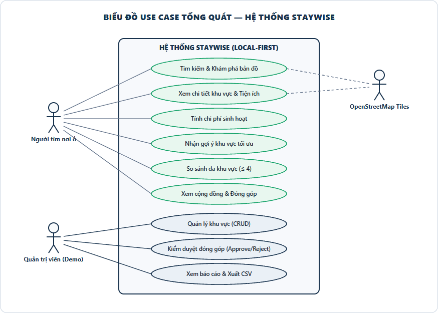

*Hình 1: Biểu đồ Use Case tổng quát hệ thống StayWise*

#### 2.4.2. Biểu đồ Use Case phía quản trị viên
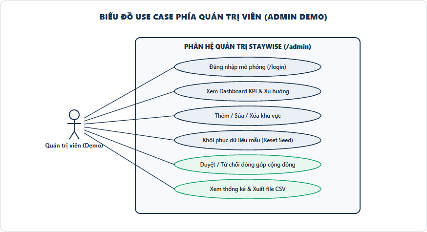

*Hình 2: Biểu đồ Use Case phía quản trị viên (Admin Demo)*

#### 2.4.3. Biểu đồ Use Case phía người dùng
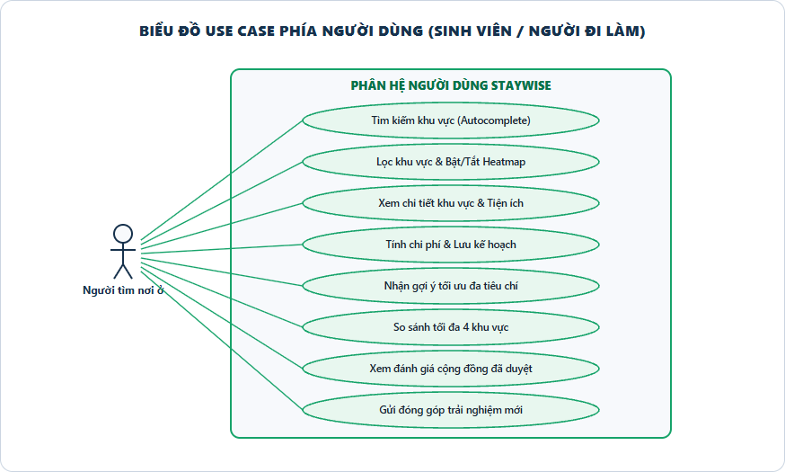

*Hình 3: Biểu đồ Use Case phía người dùng*

### 2.5. Đặc tả chi tiết các Use Case chính

#### 2.5.1. Use Case khám phá khu vực và xem bản đồ nhiệt (UC_01)

| Mục | Nội dung đặc tả |
|---|---|
| **Mã Use Case** | `UC_01` |
| **Tên Use Case** | Khám phá khu vực và xem bản đồ nhiệt (`/explore`) |
| **Tác nhân** | Người tìm nơi ở, OpenStreetMap Tile Server |
| **Mô tả** | Cho phép người dùng lọc danh sách 10 khu vực theo nhiều tiêu chí chi phí và môi trường sống, đồng thời quan sát trực quan trên bản đồ Leaflet kèm vùng nhiệt đa chế độ. |
| **Sự kiện kích hoạt** | Người dùng chọn mục **Khám phá** trên thanh điều hướng hoặc nhấn CTA **Khám phá bản đồ ngay** tại Trang chủ. |
| **Tiền điều kiện** | Ứng dụng đã nạp danh sách khu vực từ `StoreContext`. |
| **Luồng sự kiện chính** | **1.** Người dùng mở `/explore`. **2.** Hệ thống nạp động `LeafletMap` phía client, hiển thị 10 marker khu vực kèm thẻ giá thuê. **3.** Người dùng chọn thành phố, kéo thanh trượt giá thuê tối đa, tổng chi phí, an ninh, yên tĩnh, nguy cơ ngập. **4.** Hệ thống lọc lại danh sách `filteredAreas` và cập nhật Marker tương ứng. **5.** Người dùng chọn chế độ Heatmap (`totalCost`, `rent`, `food`, `transport`, `environment`, `flood`) hoặc bật lớp tiện ích. **6.** Bản đồ cập nhật vùng nhiệt, `MapLegend` và hiển thị Popup khi người dùng bấm vào Marker. |
| **Luồng sự kiện thay thế** | **2a.** Nếu không tải được tile OpenStreetMap (`tileerror`), hệ thống kích hoạt `OfflineMapFallback` hiển thị lưới tọa độ cục bộ. **4a.** Nếu không có khu vực nào thỏa mãn bộ lọc, hệ thống hiển thị `EmptyState` kèm nút **Đặt lại bộ lọc**. |
| **Hậu điều kiện** | Người dùng xem được danh sách và vị trí các khu vực phù hợp hoặc điều hướng sang `/areas/[slug]`. |

*Bảng 2: Đặc tả chi tiết Use Case khám phá khu vực (UC_01)*

#### 2.5.2. Use Case xem chi tiết khu vực và tiện ích lân cận (UC_02)

| Mục | Nội dung đặc tả |
|---|---|
| **Mã Use Case** | `UC_02` |
| **Tên Use Case** | Xem chi tiết khu vực và tiện ích lân cận (`/areas/[slug]`) |
| **Tác nhân** | Người tìm nơi ở |
| **Mô tả** | Hiển thị thông tin chi tiết của một khu vực gồm khoảng giá thuê, cơ cấu chi phí hàng tháng, 5 chỉ số chất lượng sống, bản đồ vị trí, tiện ích lân cận và đánh giá mẫu. |
| **Sự kiện kích hoạt** | Người dùng bấm **Chi tiết** trên `AreaCard`, chọn gợi ý từ `SearchBar` hoặc bấm liên kết trong Popup bản đồ. |
| **Tiền điều kiện** | `slug` trên đường dẫn khớp với một khu vực trong `areas`. |
| **Luồng sự kiện chính** | **1.** Hệ thống đọc `slug` từ URL params và tìm `area` tương ứng. **2.** Tính tổng chi phí tham chiếu qua `calculateAreaTotalCost()` và điểm sống tổng hợp qua `calculateOverallLivingScore()`. **3.** Hiển thị 5 khoản chi phí và vẽ `ExpensePieChart`. **4.** Hiển thị 5 thẻ chỉ số (An ninh, Yên tĩnh, Giao thông, Môi trường, Nguy cơ ngập). **5.** Hiển thị bản đồ trung tâm tại tọa độ khu vực cùng tiện ích từ `SEED_AMENITIES`; người dùng có thể lọc tiện ích theo danh mục. **6.** Hiển thị đánh giá từ `SEED_REVIEWS` và tối đa 3 khu vực cùng thành phố. |
| **Luồng sự kiện thay thế** | **1a.** Nếu `slug` không tồn tại, hệ thống gọi `notFound()` để hiển thị trang 404 tùy biến. |
| **Hậu điều kiện** | Người dùng nắm được chi tiết khu vực và có thể bấm **Thêm vào so sánh** hoặc chuyển tới `/contribute`. |

*Bảng 3: Đặc tả chi tiết Use Case xem chi tiết khu vực (UC_02)*

#### 2.5.3. Use Case tính toán chi phí sinh hoạt và lưu kế hoạch (UC_03)

| Mục | Nội dung đặc tả |
|---|---|
| **Mã Use Case** | `UC_03` |
| **Tên Use Case** | Tính toán chi phí sinh hoạt và lưu kế hoạch (`/calculator`) |
| **Tác nhân** | Người tìm nơi ở |
| **Mô tả** | Cho phép người dùng nạp nhanh số liệu tham chiếu theo khu vực hoặc tự nhập chi tiết 9 hạng mục để tính toán tổng chi tiêu, thặng dư/thâm hụt và lưu kế hoạch vào `localStorage`. |
| **Sự kiện kích hoạt** | Người dùng truy cập trang **Tính chi phí** (`/calculator`). |
| **Tiền điều kiện** | Trình duyệt hỗ trợ JavaScript và `localStorage`. |
| **Luồng sự kiện chính** | **1.** Hệ thống kiểm tra `savedCalculatorPlan` từ `StoreContext` để nạp kế hoạch đã lưu (nếu có). **2.** Người dùng có thể chọn khu vực mẫu để tự động điền giá thuê và chi phí tham chiếu. **3.** Người dùng điều chỉnh ngân sách và từng khoản chi tiêu trên `CostInputForm`. **4.** Hàm `calculateBudgetBreakdown()` tính lại ngay tổng chi phí, số dư/thâm hụt, tỷ trọng tiền thuê và cập nhật `ExpensePieChart` cùng `BudgetBarChart`. **5.** Người dùng bấm **Lưu kế hoạch**, hệ thống gọi `savePlan()` lưu xuống `localStorage` và hiện Toast thông báo. |
| **Luồng sự kiện thay thế** | **3a.** Nếu người dùng nhập số âm hoặc ký tự rỗng, hệ thống chuẩn hóa giá trị về `>= 0`. **5a.** Người dùng có thể bấm **Đặt lại** để khôi phục thông số mặc định. |
| **Hậu điều kiện** | Kế hoạch tài chính được lưu bền vững trên trình duyệt và giữ nguyên khi tải lại trang. |

*Bảng 4: Đặc tả chi tiết Use Case tính toán chi phí sinh hoạt (UC_03)*

#### 2.5.4. Use Case nhận gợi ý khu vực tối ưu đa tiêu chí (UC_04)

| Mục | Nội dung đặc tả |
|---|---|
| **Mã Use Case** | `UC_04` |
| **Tên Use Case** | Nhận gợi ý khu vực tối ưu đa tiêu chí (`/recommendations`) |
| **Tác nhân** | Người tìm nơi ở |
| **Mô tả** | Thuật toán chấm điểm đa tiêu chí minh bạch xếp hạng các khu vực theo ngân sách, trần giá thuê, điểm đến học tập/làm việc và 4 trọng số ưu tiên. |
| **Sự kiện kích hoạt** | Người dùng mở trang **Gợi ý** (`/recommendations`) và điều chỉnh `PreferenceForm`. |
| **Tiền điều kiện** | Có dữ liệu khu vực và danh sách địa điểm tham chiếu `SEED_DESTINATIONS`. |
| **Luồng sự kiện chính** | **1.** Người dùng chọn thành phố (`hanoi` hoặc `hcm`) và điểm đến mục tiêu. **2.** Nhập ngân sách tối đa, giá thuê tối đa và khoảng cách đường chim bay chấp nhận. **3.** Điều chỉnh 4 thanh trượt ưu tiên (tiết kiệm, đi lại, tiện ích, môi trường). **4.** Hàm `recommendAreas()` chuẩn hóa 4 trọng số về tổng `100%`, tính khoảng cách Haversine, chấm điểm từng thành phần trên thang `0–100` (trừ điểm khu vực vượt ngân sách/tiền thuê) và tạo danh sách lý do. **5.** Hệ thống hiển thị danh sách `RecommendationCard` xếp hạng giảm dần và biểu đồ cột Top 5. |
| **Luồng sự kiện thay thế** | **4a.** Nếu danh sách khu vực rỗng, hệ thống hiển thị `EmptyState` với nút **Khôi phục tiêu chí mặc định**. |
| **Hậu điều kiện** | Người dùng nhận được bảng xếp hạng minh bạch kèm lý do định lượng cho từng khu vực. |

*Bảng 5: Đặc tả chi tiết Use Case nhận gợi ý khu vực (UC_04)*

#### 2.5.5. Use Case so sánh đối đầu đa khu vực (UC_05)

| Mục | Nội dung đặc tả |
|---|---|
| **Mã Use Case** | `UC_05` |
| **Tên Use Case** | So sánh đối đầu đa khu vực (`/compare`) |
| **Tác nhân** | Người tìm nơi ở |
| **Mô tả** | Cho phép đối chiếu trực tiếp tối đa 4 khu vực trên bảng ma trận 12 tiêu chí, biểu đồ cột chồng chi phí, biểu đồ Radar môi trường sống và 4 thẻ kết luận tự động. |
| **Sự kiện kích hoạt** | Người dùng chọn nút so sánh trên các thẻ khu vực và truy cập `/compare`. |
| **Tiền điều kiện** | Có ít nhất 1 khu vực trong `comparisonIds`. |
| **Luồng sự kiện chính** | **1.** Hệ thống lấy các khu vực khớp `comparisonIds` (mặc định `["cau-giay", "my-dinh"]`). **2.** Hàm `findComparisonHighlights()` xác định khu vực chi phí thấp nhất, môi trường tốt nhất, an ninh cao nhất và nhiều tiện ích nhất. **3.** Hiển thị bảng ma trận 12 dòng với cột tiêu chí cố định (`sticky`), gắn nhãn `Tiết kiệm nhất` cho khu vực có tổng chi phí thấp nhất. **4.** Hiển thị `ComparisonBarChart` và `LivingScoreRadarChart` cùng 4 thẻ kết luận. **5.** Người dùng có thể xóa bớt khu vực hoặc xóa tất cả. |
| **Luồng sự kiện thay thế** | **1a.** Nếu người dùng chọn đủ 4 khu vực và bấm thêm khu vực thứ 5, `toggleComparison()` giữ nguyên tối đa 4 khu vực. **5a.** Nếu xóa hết khu vực, hiển thị `EmptyState` cho phép thêm lại khu vực mẫu. |
| **Hậu điều kiện** | Danh sách `comparisonIds` được đồng bộ vào `localStorage`. |

*Bảng 6: Đặc tả chi tiết Use Case so sánh khu vực (UC_05)*

#### 2.5.6. Use Case đóng góp trải nghiệm và kiểm duyệt cộng đồng (UC_06)

| Mục | Nội dung đặc tả |
|---|---|
| **Mã Use Case** | `UC_06` |
| **Tên Use Case** | Đóng góp trải nghiệm và kiểm duyệt cộng đồng (`/contribute`, `/admin/contributions`, `/community`) |
| **Tác nhân** | Người tìm nơi ở, Quản trị viên Demo |
| **Mô tả** | Quản lý vòng đời đóng góp từ lúc người dùng gửi lên (`pending`), qua kiểm duyệt Admin (`approved` / `rejected`) đến khi hiển thị công khai trên bảng tin cộng đồng. |
| **Sự kiện kích hoạt** | Người dùng gửi biểu mẫu tại `/contribute`; Admin xử lý hàng đợi tại `/admin/contributions`. |
| **Tiền điều kiện** | Dữ liệu biểu mẫu phải vượt qua schema kiểm tra của Zod. |
| **Luồng sự kiện chính** | **1.** Tại `/contribute`, người dùng nhập tên, chọn khu vực, chủ đề, đánh giá 1–5 sao và nội dung. **2.** React Hook Form kiểm tra qua `contributionFormSchema`. Nếu hợp lệ, `submitContribution()` tạo bản ghi với `status = "pending"` lưu vào `localStorage` và hiện Toast. **3.** Bài gửi xuất hiện ngay trong mục **Lịch sử đóng góp trên thiết bị này** với nhãn `Chờ Admin duyệt`, nhưng chưa xuất hiện trên `/community`. **4.** Tại `/admin/contributions`, Admin lọc tab `Chờ duyệt` và bấm **Duyệt**. **5.** `approveContribution()` đổi `status = "approved"` và cập nhật `localStorage`. **6.** Khi truy cập `/community`, bài viết đã duyệt hiển thị công khai trên bảng tin. |
| **Luồng sự kiện thay thế** | **2a.** Nếu bỏ trống hoặc nội dung dưới 10 ký tự, Zod chặn gửi và hiển thị lỗi dưới trường tương ứng. **4a.** Nếu Admin bấm **Từ chối**, trạng thái đổi thành `rejected` và bài viết không hiển thị trên `/community`. |
| **Hậu điều kiện** | Trạng thái kiểm duyệt được bảo toàn sau khi tải lại trang. |

*Bảng 7: Đặc tả chi tiết Use Case đóng góp và kiểm duyệt (UC_06)*

#### 2.5.7. Use Case quản lý danh mục khu vực và xuất báo cáo CSV (UC_07)

| Mục | Nội dung đặc tả |
|---|---|
| **Mã Use Case** | `UC_07` |
| **Tên Use Case** | Quản lý danh mục khu vực và xuất báo cáo CSV (`/admin/areas`, `/admin/reports`) |
| **Tác nhân** | Quản trị viên Demo |
| **Mô tả** | Cho phép quản trị viên tìm kiếm, thêm, sửa, xóa khu vực, khôi phục bộ dữ liệu mẫu gốc và xuất toàn bộ bảng dữ liệu ra tập tin CSV. |
| **Sự kiện kích hoạt** | Admin truy cập `/admin/areas` hoặc `/admin/reports`. |
| **Tiền điều kiện** | Admin đang ở phân hệ quản trị mô phỏng. |
| **Luồng sự kiện chính** | **1.** Tại `/admin/areas`, Admin xem bảng 10 khu vực, tìm kiếm theo tên hoặc lọc theo thành phố. **2.** Bấm **Thêm khu vực mới** hoặc biểu tượng sửa để mở `AreaEditModal`, xác thực bằng `areaFormSchema` và lưu vào `StoreContext` + `localStorage`. **3.** Bấm xóa để mở `ConfirmationDialog` xác nhận trước khi gỡ khu vực. **4.** Tại `/admin/reports`, bấm **Tải về CSV ngay** để gọi `exportAreasToCSV(areas)` xuất file `StayWise_Areas_Report_YYYY-MM-DD.csv` có UTF-8 BOM. |
| **Luồng sự kiện thay thế** | **3a.** Nếu muốn đưa dữ liệu về trạng thái ban đầu, Admin bấm **Khôi phục Seed Data** và xác nhận để gọi `resetAllData()`. |
| **Hậu điều kiện** | Thay đổi danh mục khu vực cập nhật đồng thời sang toàn bộ trang người dùng. |

*Bảng 8: Đặc tả chi tiết Use Case quản trị khu vực và xuất CSV (UC_07)*

### 2.6. Thiết kế kiến trúc và luồng xử lý

#### 2.6.1. Kiến trúc phân tầng hệ thống
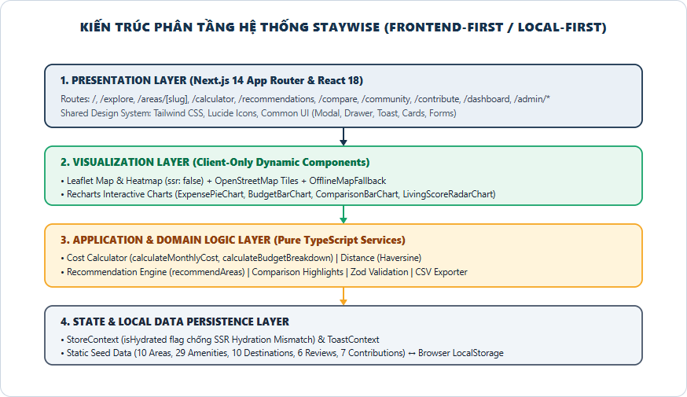

*Hình 4: Kiến trúc phân tầng hệ thống StayWise (Frontend-first / Local-first)*

#### 2.6.2. Biểu đồ trình tự chức năng gợi ý khu vực tối ưu
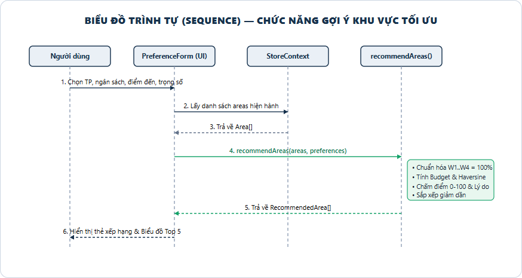

*Hình 5: Biểu đồ trình tự (Sequence Diagram) — Chức năng Gợi ý khu vực tối ưu*

#### 2.6.3. Biểu đồ trình tự chức năng đóng góp và kiểm duyệt
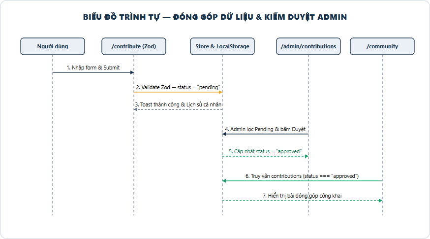

*Hình 6: Biểu đồ trình tự (Sequence Diagram) — Đóng góp dữ liệu và Kiểm duyệt Admin*

### 2.7. Thiết kế cấu trúc dữ liệu và lưu trữ cục bộ

Thay vì cơ sở dữ liệu quan hệ rời, StayWise tổ chức dữ liệu theo các thực thể TypeScript chặt chẽ liên kết qua khóa `areaId` và lưu trữ trạng thái động trong `localStorage` qua 4 khóa: `staywise_areas`, `staywise_contributions`, `staywise_comparison_ids` và `staywise_saved_calculator_plan`.

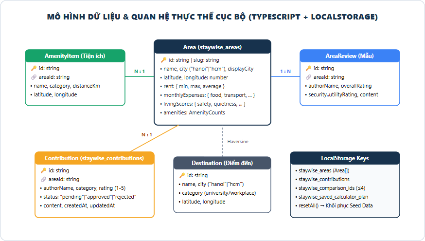

*Hình 7: Mô hình dữ liệu và quan hệ thực thể cục bộ của StayWise*

Bộ dữ liệu mẫu ban đầu gồm 10 khu vực tham chiếu (dữ liệu minh họa, đơn vị triệu đồng/tháng) trong `src/data/areas.ts`:

| Khu vực (`id`) | Thành phố | Tọa độ (Lat, Lng) | Thuê TB | Ăn uống | Đi lại | Điện/Nước/Net | Khác | Tổng CP tính toán |
|---|---|---|---:|---:|---:|---:|---:|---:|
| Cầu Giấy (`cau-giay`) | Hà Nội | `21.030, 105.790` | 4.20 | 2.60 | 0.80 | 0.65 | 1.10 | **9.35** |
| Mỹ Đình (`my-dinh`) | Hà Nội | `21.028, 105.770` | 3.80 | 2.50 | 0.85 | 0.65 | 1.00 | **8.80** |
| Hà Đông (`ha-dong`) | Hà Nội | `20.971, 105.779` | 3.20 | 2.40 | 0.90 | 0.62 | 0.95 | **8.07** |
| Đống Đa (`dong-da`) | Hà Nội | `21.018, 105.826` | 4.50 | 2.80 | 0.75 | 0.70 | 1.20 | **9.95** |
| Long Biên (`long-bien`) | Hà Nội | `21.046, 105.895` | 3.30 | 2.50 | 0.90 | 0.65 | 1.00 | **8.35** |
| Thủ Đức (`thu-duc`) | TP.HCM | `10.850, 106.770` | 3.80 | 2.80 | 1.00 | 0.70 | 1.20 | **9.50** |
| Bình Thạnh (`binh-thanh`) | TP.HCM | `10.810, 106.710` | 4.60 | 2.90 | 0.85 | 0.72 | 1.20 | **10.27** |
| Gò Vấp (`go-vap`) | TP.HCM | `10.840, 106.670` | 3.30 | 2.60 | 1.00 | 0.65 | 1.00 | **8.55** |
| Tân Bình (`tan-binh`) | TP.HCM | `10.800, 106.650` | 4.20 | 2.80 | 0.85 | 0.70 | 1.15 | **9.70** |
| Khu vực Quận 7 (`quan-7`) | TP.HCM | `10.730, 106.720` | 4.80 | 3.00 | 0.90 | 0.75 | 1.30 | **10.75** |

*Bảng 9: Bộ dữ liệu tham chiếu 10 khu vực trong hệ thống StayWise (Dữ liệu minh họa)*

---

## CHƯƠNG 3. CHƯƠNG TRÌNH THỬ NGHIỆM VÀ KẾT QUẢ

### 3.1. Giao diện và kết quả thử nghiệm phía người dùng

#### 3.1.1. Giao diện trang chủ (`/`)
Trang chủ hiển thị thanh điều hướng chính, khu vực Hero kèm ô tìm kiếm có gợi ý tự động, 4 thẻ thống kê tổng hợp từ dữ liệu thực tế, bản đồ xem trước và danh sách khu vực tiêu biểu.

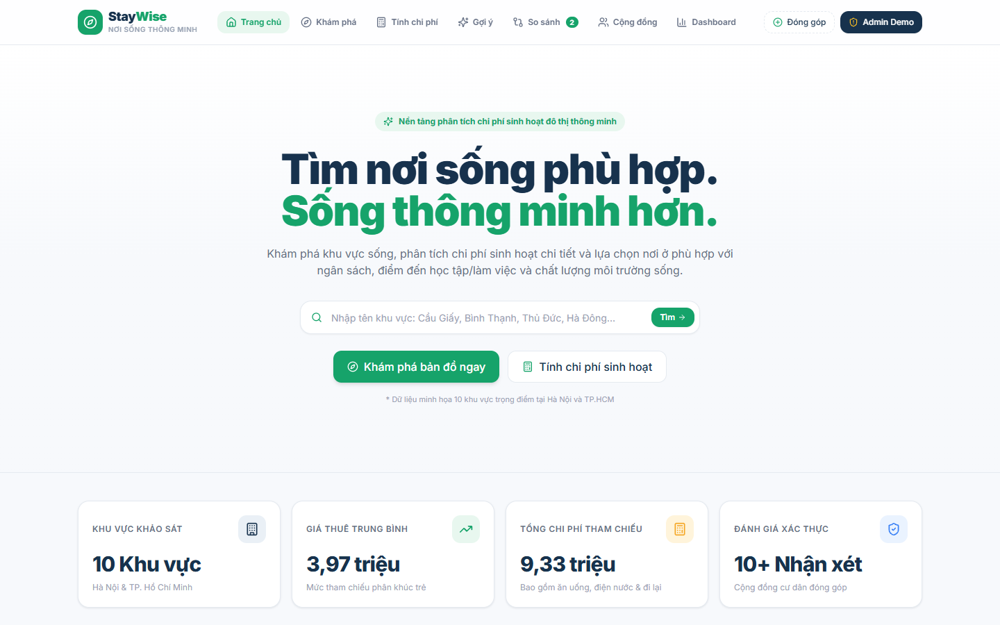

*Hình 8: Giao diện trang chủ StayWise (`/`)*

#### 3.1.2. Giao diện khám phá khu vực và bản đồ nhiệt (`/explore`)
Trang khám phá bố trí bộ lọc đa tiêu chí ở cột trái, khu vực điều khiển lớp Heatmap/tiện ích ở phía trên và bản đồ Leaflet tương tác kết hợp danh sách thẻ khu vực ở bên phải.

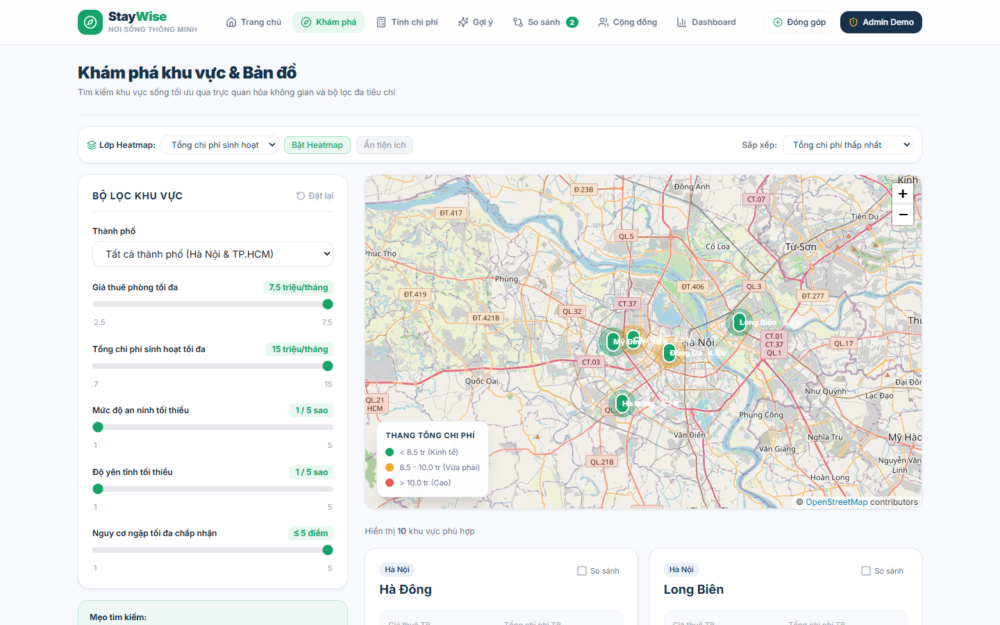

*Hình 9: Giao diện trang Khám phá khu vực và Bản đồ nhiệt (`/explore`)*

#### 3.1.3. Giao diện chi tiết khu vực (`/areas/[slug]`)
Hiển thị thông tin chi tiết của khu vực (ví dụ Cầu Giấy), hộp tổng quan giá thuê, các điểm nổi bật, biểu đồ phân bổ chi phí và tiện ích lân cận.

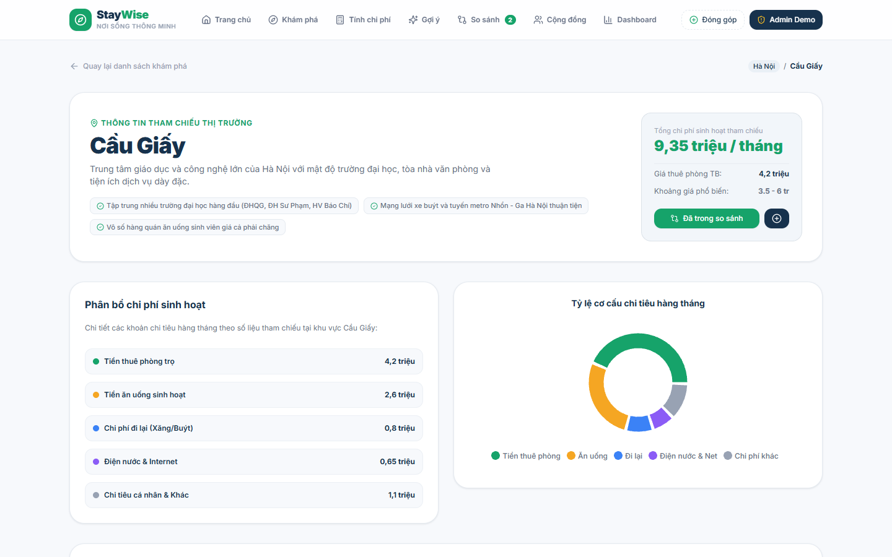

*Hình 10: Giao diện trang Chi tiết khu vực (`/areas/cau-giay`)*

#### 3.1.4. Giao diện tính chi phí sinh hoạt (`/calculator`)
Cho phép nạp nhanh dữ liệu mẫu từ 10 khu vực, tùy chỉnh từng khoản chi tiêu và theo dõi ngay trạng thái thặng dư/thâm hụt cùng biểu đồ Pie/Bar.

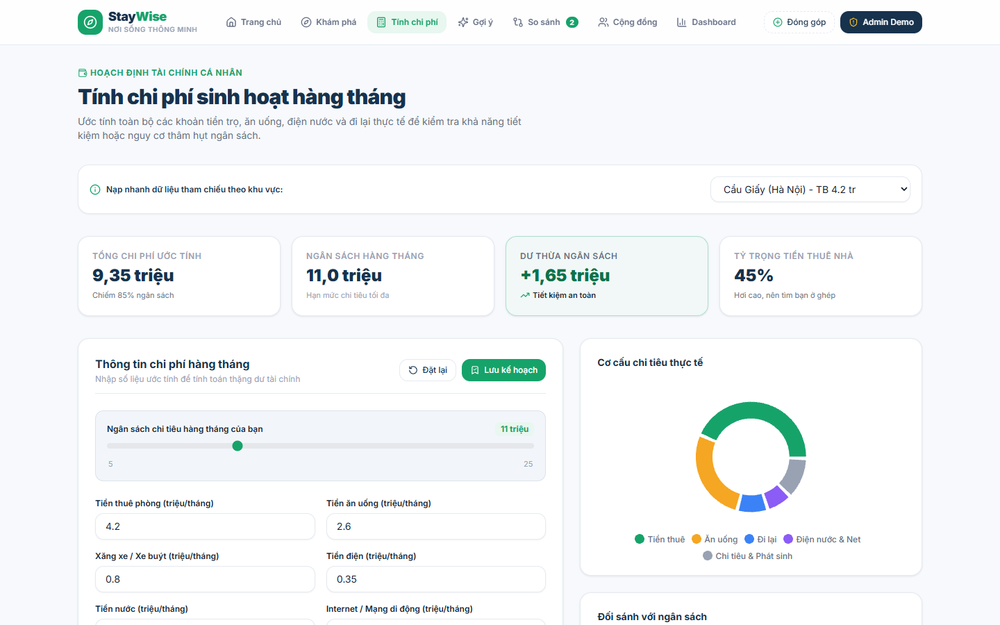

*Hình 11: Giao diện Công cụ tính chi phí sinh hoạt (`/calculator`)*

#### 3.1.5. Giao diện gợi ý khu vực tối ưu (`/recommendations`)
Hiển thị biểu mẫu khảo sát nhu cầu ở cột trái và danh sách khu vực xếp hạng kèm điểm thành phần, số dư ngân sách và các lý do đề xuất minh bạch ở cột phải.

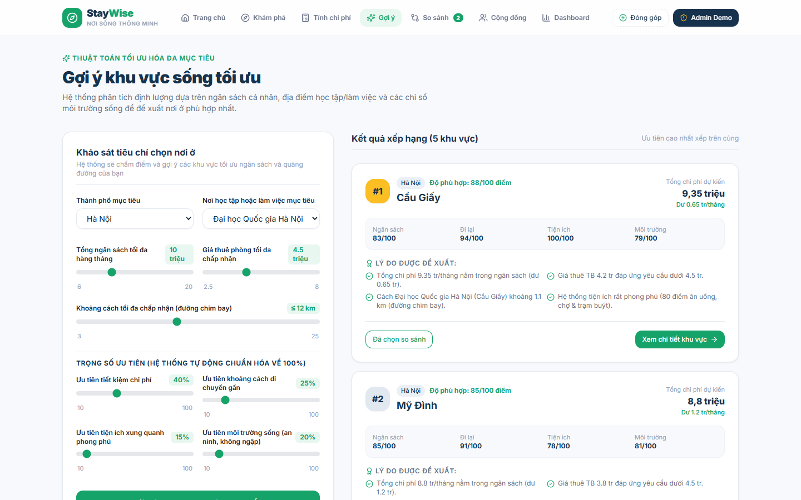

*Hình 12: Giao diện trang Gợi ý khu vực tối ưu (`/recommendations`)*

#### 3.1.6. Giao diện so sánh đối đầu (`/compare`)
Hiển thị các thẻ khu vực đang chọn, bảng ma trận đối chiếu 12 tiêu chí (highlight khu vực tiết kiệm nhất), biểu đồ Stacked Bar chi phí và Radar Chart môi trường sống.

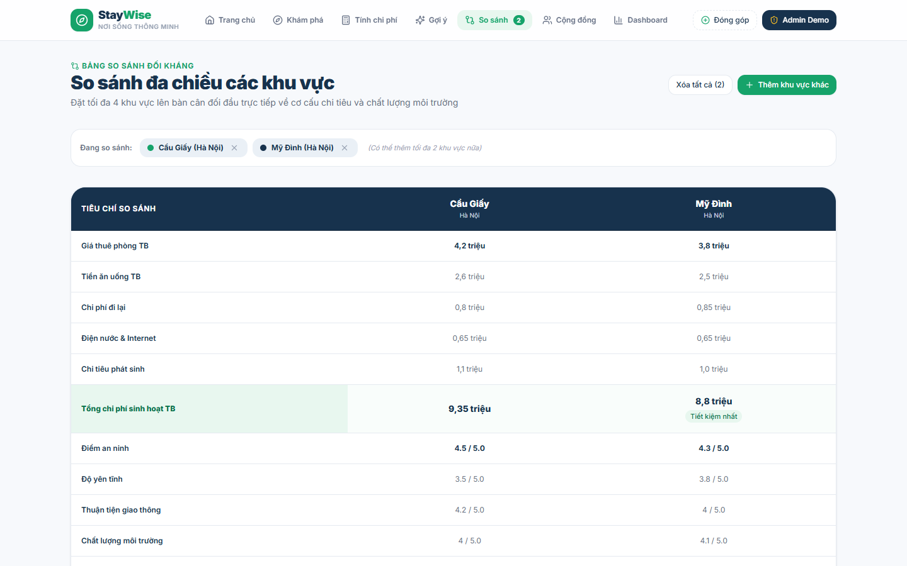

*Hình 13: Giao diện trang So sánh khu vực (`/compare`)*

#### 3.1.7. Giao diện bảng tin cộng đồng (`/community`)
Tổng hợp số lượng đánh giá đã duyệt, số khu vực có đánh giá, điểm hài lòng bình quân và danh sách nhận xét đã qua kiểm duyệt kèm bộ lọc thành phố/khu vực/chủ đề.

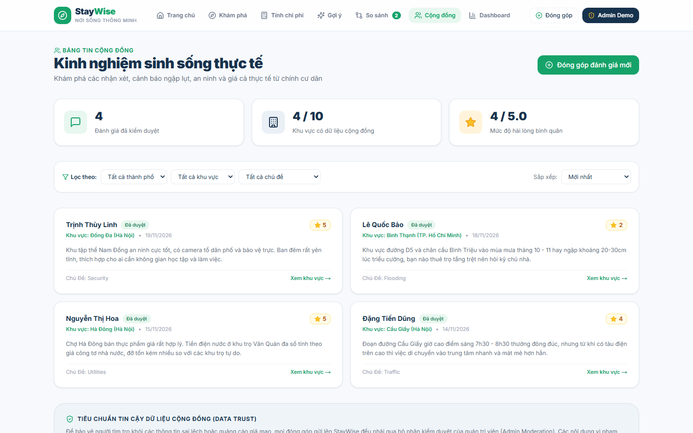

*Hình 14: Giao diện Bảng tin cộng đồng (`/community`)*

#### 3.1.8. Giao diện đóng góp dữ liệu (`/contribute`)
Cung cấp biểu mẫu gửi đánh giá có kiểm tra Zod và bảng theo dõi lịch sử đóng góp lưu trên `localStorage` của thiết bị.

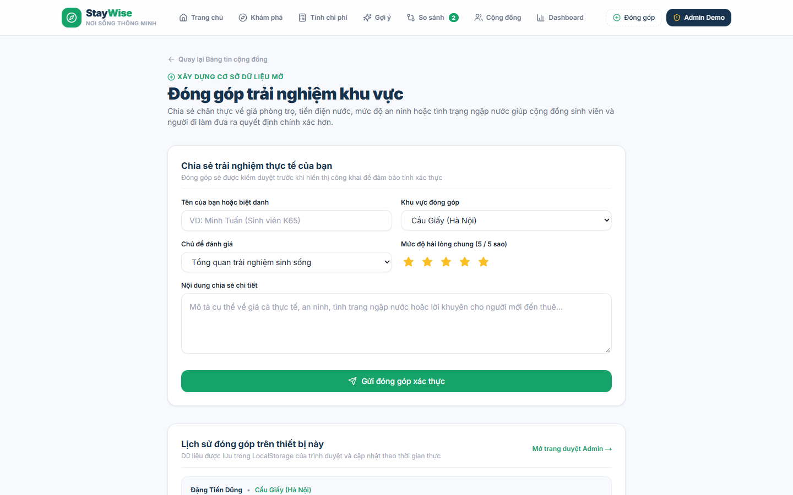

*Hình 15: Giao diện trang Đóng góp trải nghiệm (`/contribute`)*

#### 3.1.9. Giao diện Dashboard phân tích đô thị (`/dashboard`)
Hiển thị 5 thẻ KPI, biểu đồ so sánh giá thuê & tổng chi phí giữa các khu vực, 4 bảng xếp hạng Top 3 và bản đồ nhiệt tổng thể.

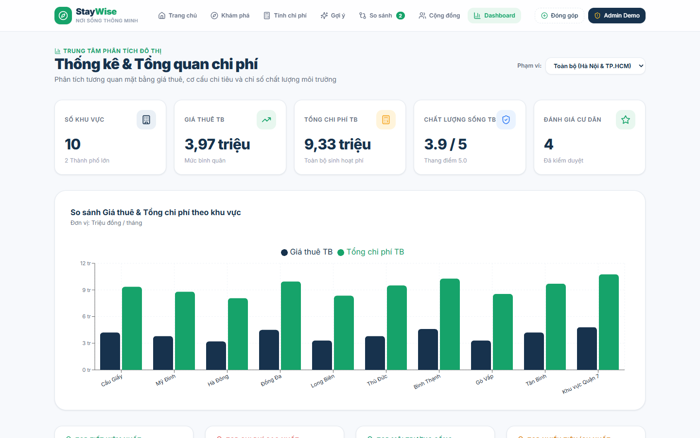

*Hình 16: Giao diện Trung tâm phân tích đô thị (`/dashboard`)*

#### 3.1.10. Giao diện đáp ứng trên thiết bị di động (Mobile `390×844`)
Trên màn hình nhỏ, trang `/explore` chuyển đổi mượt mà sang thanh tab `[Danh sách]` / `[Bản đồ]` và nút mở Drawer bộ lọc để không gây tràn ngang hay kẹt thao tác cuộn.

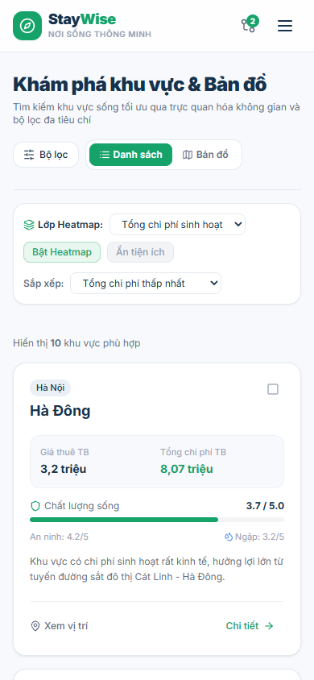

*Hình 17: Giao diện đáp ứng Mobile (`390×844`) của trang Khám phá*

### 3.2. Giao diện và kết quả thử nghiệm phía quản trị viên

#### 3.2.1. Giao diện tổng quan Admin (`/admin`)
Hiển thị thanh Sidebar điều hướng quản trị, nhãn thông báo chế độ Demo Local, 5 thẻ KPI (tổng khu vực, tổng đóng góp, chờ duyệt, đã duyệt, từ chối) và biểu đồ xu hướng đóng góp theo ngày.

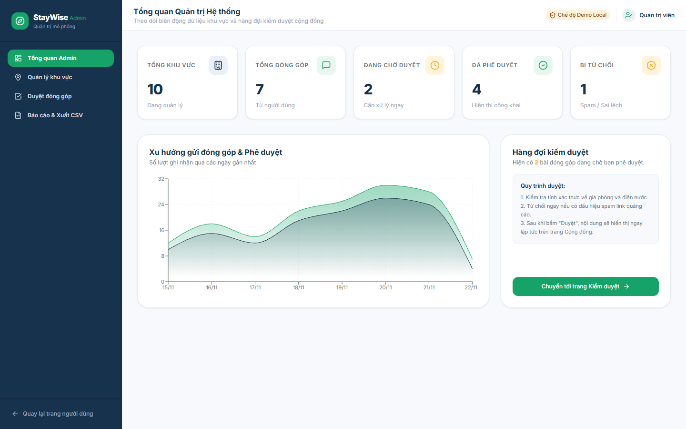

*Hình 18: Giao diện Tổng quan Quản trị (`/admin`)*

#### 3.2.2. Giao diện quản lý khu vực (`/admin/areas`)
Cung cấp bảng danh sách khu vực với tọa độ, giá thuê, tổng chi phí, điểm an ninh/ngập lụt cùng các nút Thêm mới, Sửa, Xóa và Khôi phục Seed Data.

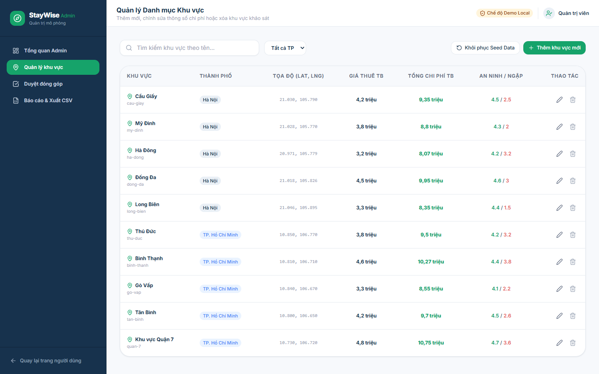

*Hình 19: Giao diện Quản lý danh mục khu vực (`/admin/areas`)*

#### 3.2.3. Giao diện kiểm duyệt đóng góp (`/admin/contributions`)
Phân loại bài đóng góp theo 4 tab trạng thái (`Chờ duyệt`, `Đã duyệt`, `Từ chối`, `Tất cả`) kèm nút Duyệt / Từ chối tác động trực tiếp tới dữ liệu hiển thị trên `/community`.

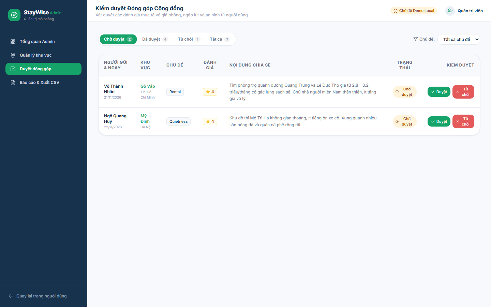

*Hình 20: Giao diện Kiểm duyệt đóng góp (`/admin/contributions`)*

#### 3.2.4. Giao diện báo cáo và xuất CSV (`/admin/reports`)
Hiển thị tỷ lệ phê duyệt, tỷ lệ từ chối, mức độ hoàn thiện dữ liệu và nút tải file CSV chuẩn UTF-8.

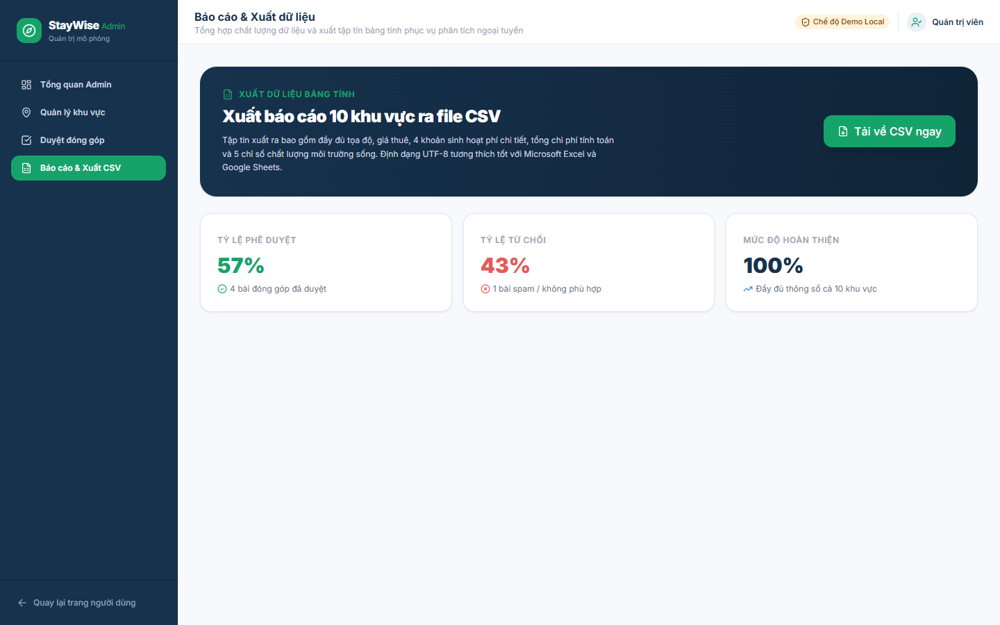

*Hình 21: Giao diện Báo cáo & Xuất dữ liệu CSV (`/admin/reports`)*

### 3.3. Kết quả kiểm thử và đánh giá hệ thống

Quá trình kiểm thử được thực thi trực tiếp trên sản phẩm chạy tại `http://localhost:3000` kết hợp kiểm tra tĩnh và Unit Test:

| Nhóm kiểm thử | Nội dung kiểm chứng thực tế | Trạng thái | Ghi chú |
|---|---|:---:|---|
| Kiểm tra tĩnh (`typecheck` & `lint`) | `tsc --noEmit` và `next lint` | **PASS** | 0 lỗi TypeScript, 0 cảnh báo ESLint. |
| Unit Test (`vitest run`) | 4 file test (`cost`, `distance`, `scores`, `recommendation-engine`) | **PASS** | 10/10 test cases đạt yêu cầu. |
| Build Production (`next build`) | Biên dịch toàn bộ 16 routes App Router | **PASS** | Đã kiểm chứng biên dịch thành công trước khi chạy thử. |
| Kịch bản E2E 1–7 (Puppeteer) | Trang chủ, Explore Map, Chi tiết khu vực, Calculator, Recommendations, Compare, Contribute $\to$ Admin Approve $\to$ Community | **PASS** | 7/7 kịch bản hoàn thành chính xác; dữ liệu `localStorage` đồng bộ ngay. |
| Tải OpenStreetMap Tiles khi chạy Headless | Tải tile từ máy chủ OSM bên ngoài | **BLOCKED / FALLBACK** | Một số tile trả về `net::ERR_EMPTY_RESPONSE` trong môi trường tự động; hệ thống xử lý bằng `OfflineMapFallback`. |
| Xuất CSV (`/admin/reports`) & CRUD Khu vực (`/admin/areas`) | Kiểm tra qua tương tác trình duyệt tự động | **NOT TESTED (E2E)** | Đã kiểm chứng logic trong mã nguồn và hiển thị giao diện trang, chưa chạy kịch bản click tự động tải file CSV. |

*Bảng 10: Tổng hợp kết quả kiểm thử hệ thống StayWise*

#### Đánh giá tổng quan và hạn chế hiện tại
- **Ưu điểm**: Toàn bộ chức năng tính toán, lọc, gợi ý đa tiêu chí, so sánh và kiểm duyệt hoạt động thực tế bằng dữ liệu nhất quán trên giao diện tiếng Việt đồng bộ; không phụ thuộc API trả phí; xử lý an toàn SSR và Hydration Mismatch.
- **Hạn chế cần lưu ý**:
  1. Dữ liệu 10 khu vực mang tính minh họa tham chiếu; khoảng cách đến điểm đến là khoảng cách đường chim bay (Haversine).
  2. Hệ thống lưu trữ bằng `localStorage` phía trình duyệt và trang `/login` chỉ là giao diện mô phỏng, chưa có Backend Database và phân quyền JWT thực tế.
  3. Trong `src/app/areas/[slug]/page.tsx`, mục đánh giá cư dân hiện đọc từ `SEED_REVIEWS` tĩnh, chưa hợp nhất thêm các bài `contributions` mới được duyệt của khu vực đó (các bài duyệt mới hiện hiển thị tập trung tại `/community`).
- **Định hướng phát triển**: Tích hợp Backend (PostgreSQL/PostGIS hoặc Supabase), xác thực JWT cho Admin, tích hợp OSRM tính khoảng cách giao thông thực tế và hợp nhất đánh giá cộng đồng đã duyệt vào từng trang chi tiết khu vực.

---

## TÀI LIỆU THAM KHẢO

[1] Vercel, *Next.js App Router Documentation (v14)*. https://nextjs.org/docs  
[2] Meta Platforms, *React Documentation (v18)*. https://react.dev/  
[3] Microsoft, *TypeScript Documentation*. https://www.typescriptlang.org/docs/  
[4] Tailwind Labs, *Tailwind CSS Documentation (v3)*. https://tailwindcss.com/docs  
[5] Vladimir Agafonkin, *Leaflet — An Open-Source JavaScript Library for Interactive Maps*. https://leafletjs.com/  
[6] Paul Le Cam, *React Leaflet Documentation*. https://react-leaflet.js.org/  
[7] OpenStreetMap Contributors, *OpenStreetMap Tile Usage & Copyright*. https://www.openstreetmap.org/copyright  
[8] Recharts Group, *Recharts — A Composable Charting Library Built on React Components*. https://recharts.org/  
[9] React Hook Form & Colin McDonnell, *React Hook Form & Zod Validation Documentation*. https://react-hook-form.com/ và https://zod.dev/  
[10] Lucide Contributors, *Lucide React Icon Library*. https://lucide.dev/  
[11] Vitest & Puppeteer Teams, *Vitest & Puppeteer Documentation*. https://vitest.dev/ và https://pptr.dev/  
